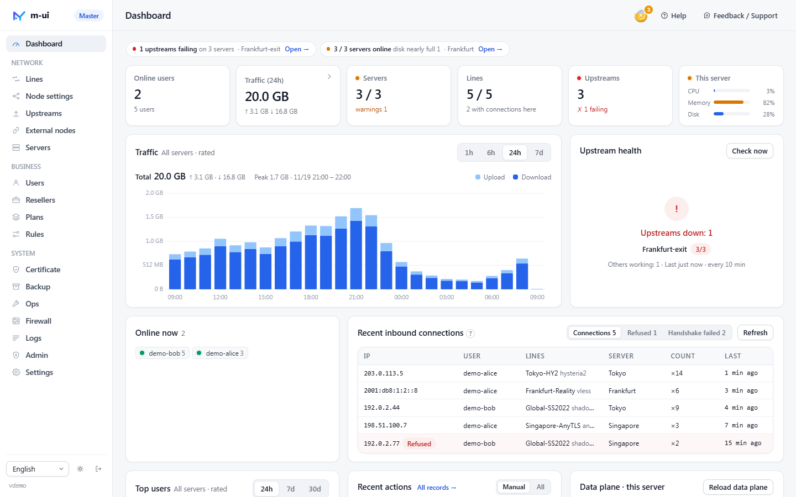
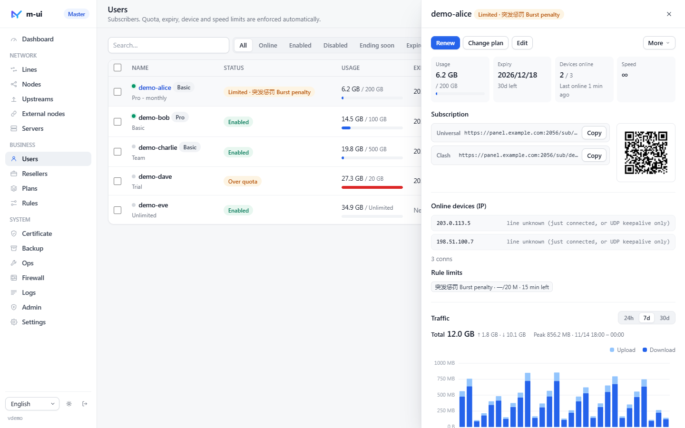
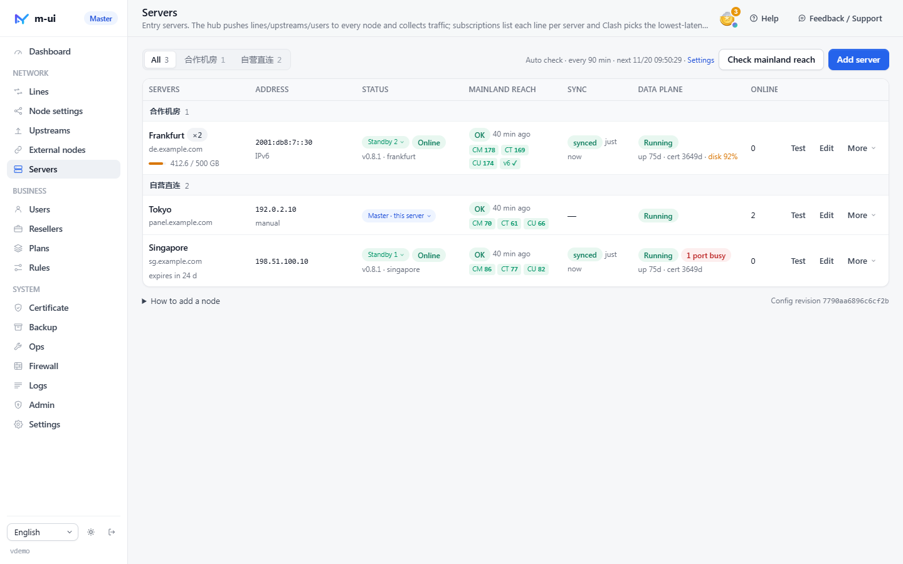
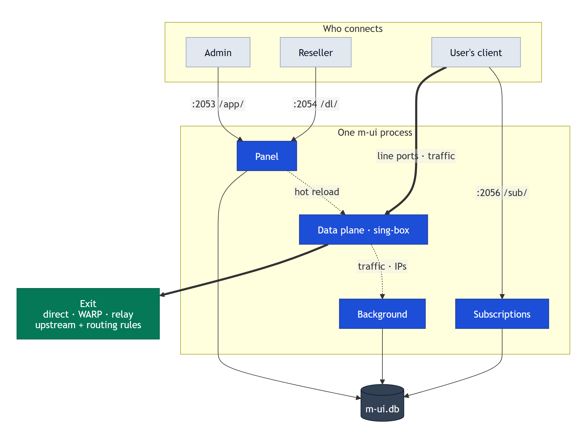
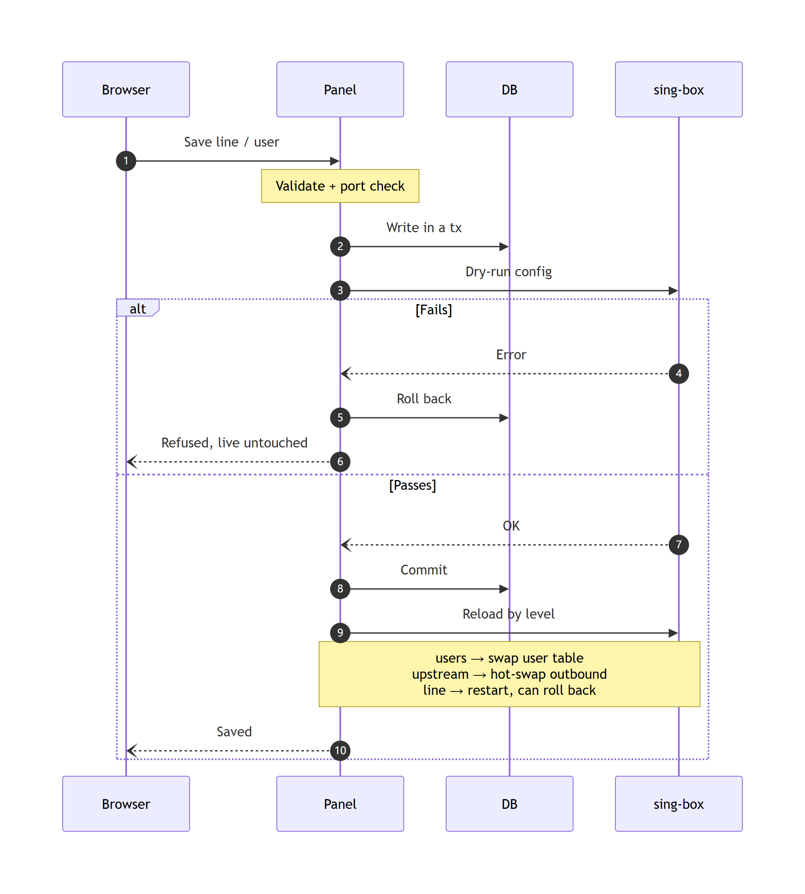
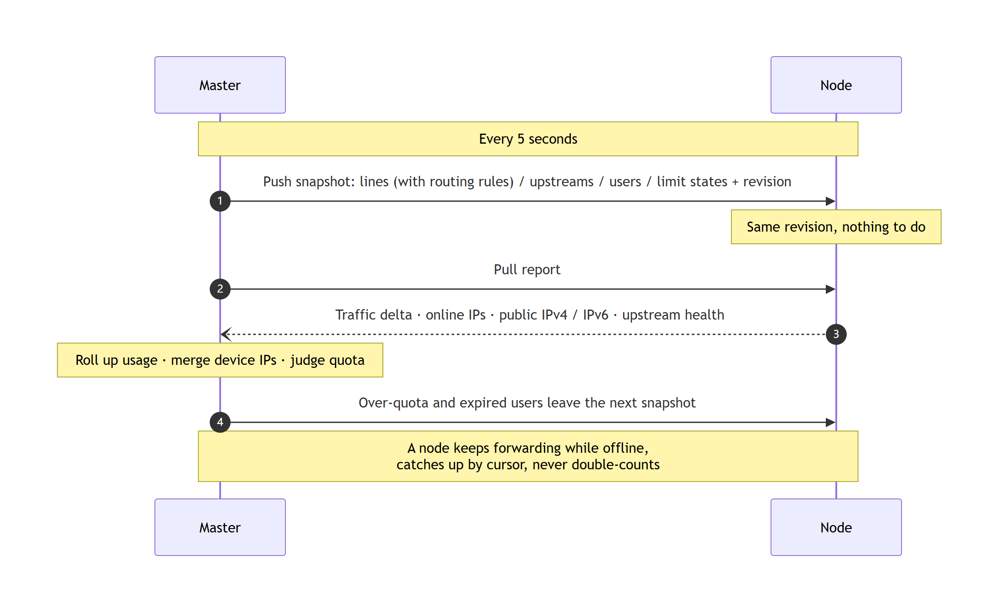
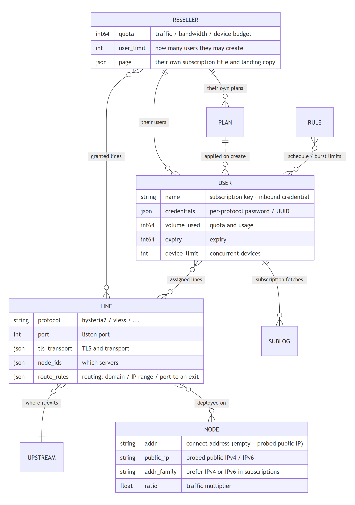

<p align="center"></p>
<h1 align="center">m-ui</h1>
<p align="center">An embedded <a href="https://github.com/SagerNet/sing-box">sing-box</a> control plane for self-hosted and multi-server deployments · one Go binary · lines instead of inbound/outbound/route · every apply is dry-run and rolled back on failure · one master for all your servers</p>
<p align="center"><sub>m-ui · sing-box panel by <a href="https://github.com/Maoyangui">Maoyangui</a> · Go · Linux · GPL-3.0 — not related to other projects named “m-ui”</sub></p>
<p align="center"><a href="README.md">中文</a> · <b>English</b> · <a href="https://maoyangui.github.io/m-ui/">Docs</a> · <a href="https://maoyangui.github.io/m-ui/demo/">Live demo</a> · <a href="#architecture">Architecture</a> · <a href="https://github.com/Maoyangui/m-ui/releases">Download</a></p>
<p align="center">
  <a href="https://github.com/Maoyangui/m-ui/actions/workflows/ci.yml"></a>
  <a href="https://github.com/Maoyangui/m-ui/actions/workflows/install-test.yml"></a>
  <a href="https://github.com/Maoyangui/m-ui/releases/latest"></a>
  <a href="LICENSE"></a>
</p>

---

**One-line install** (Debian / Ubuntu, as root):

```bash
bash <(curl -fsSL https://raw.githubusercontent.com/Maoyangui/m-ui/main/deploy/install.sh)
```

Then open `http://<server-ip>:2053/app/`, default login `admin / admin` (change it on the Admin page right after). **No domain needed**: self-sign a certificate with one click → create a line → create a user → send the subscription link — five minutes end to end. See [Installation](#installation) and [Quick start](#quick-start).

**Want to look before you install?** The [live demo](https://maoyangui.github.io/m-ui/demo/) is the real panel interface running on sample data: no login, no backend, click anything, refresh to reset. Append `--dry-run` to the install command to see which files it would write first.

**Rather not run your own server?** [Get a ready-made subscription](https://godusevpn.org/subscription/) and just install the client.

<p align="center"></p>

## What it is

m-ui is a self-hosted proxy panel: **one binary, one database file**, with sing-box embedded. Lines, users, subscriptions, certificates, backups and every server you own are managed from the web UI.

Four things it does differently:

- **A line is one thing** — inbound protocol + port → where it exits. No separate inbound / outbound / routing tables to keep in sync.
- **Saving can't break you** — every save is dry-run through sing-box first, so a broken config never reaches the database. Users and upstreams are hot-swapped; only line changes restart the data plane, and if the new config passes validation yet still fails to start (say another process grabbed the port), m-ui rolls back to the last working one.
- **One master, many nodes, and a standby when the master dies** — the master pushes lines and users to any number of nodes, collects their traffic and enforces quota centrally. Subscriptions list every line once per server, so clients pick the lowest-latency entry themselves. With master failover on, a standby takes over with an encrypted copy of the data when the master goes down, and subscription addresses can stay the same.
- **Ops without leaving the panel** — Let's Encrypt issuance and renewal, Cloudflare WARP, kernel tuning, backup / restore, a migration wizard, Telegram alerts, two-factor login and an external API.

The same panel runs a single server for yourself and a production service with dozens of servers, thousands of users and resellers: the master manages lines, users, plans and resellers (each reseller gets its own panel, quota and users) while nodes only run the data plane; quotas, expiry and device limits are enforced across every server; and the external API plugs straight into a shop or a Telegram bot.

## Features

| Area | What you get |
|---|---|
| Lines | Hysteria2, AnyTLS, TUIC, Trojan, VLESS (Reality / Vision), VMess, Shadowsocks (incl. 2022), SOCKS, HTTP, Mixed; WS / gRPC / HTTPUpgrade / HTTP transports; Hysteria2 port hopping and masquerade site; one-click check of Reality handshake targets; per-server deployment; rule-based routing (send domains / IP ranges / ports to different exits); **relay entries** (reach a line through another server or an outside relay; encrypted traffic is passed through as is, UDP included, and subscriptions gain the nodes automatically) |
| Node settings | Every node in a subscription (a line's direct entry on one server, or one of its relay entries) can have its own traffic ratio, total speed limit, per-user speed limit and online-user cap, or be left out of subscriptions; the page is grouped by line (collapsed by default when there are many nodes), each line row summarises its nodes and opens to show them; relay entries can also be ticked one by one in the user / plan line picker |
| Upstreams | VLESS / VMess / Trojan / TUIC / Hysteria2 / Shadowsocks / SOCKS exits, import by pasting a share link; latency test, periodic health checks measured **on the servers that actually use the upstream**, failure / recovery alerts naming the server; one-click WARP; **a line can be an upstream** (chained proxy); **upstream groups** use the fastest member that works and switch automatically when it fails; tick several to test, group or delete them together |
| Users | Quota, expiry, periodic reset, concurrent device limit (by source IP: IPv4 addresses and IPv6 /64s counted separately, merged across servers; connections that arrive through a relay entry don't take a slot), up / down speed limits; auto-disable and kick on overuse or expiry; bulk create, bulk actions, CSV export. Reseller-owned users stay in the reseller's panel and out of the main user list |
| Plans | Templates for quota / duration / devices / speed / lines; apply on create, renew (several periods at once) or extend; change plans by replacing, stacking or prorating at a reference price, previewed before you confirm; can bind speed-limit rules for current and future users of the plan |
| Resellers | Give a reseller lines plus traffic / device / bandwidth budgets and an expiry; they create users and plans in their own panel (port 2054, path /dl). Usage rolls up to the reseller, and going over quota, expiring or being disabled cuts off all of their users at once |
| Subscriptions | Universal link, Clash and sing-box formats, the right one picked per client from a single address; custom Clash / sing-box templates; external nodes can be hidden, renamed, excluded by keyword and tested from mainland China; landing page in the browser (usage, expiry, one-tap import, QR); users can hand out a temporary share link themselves; external nodes / external subscriptions merged in (each external subscription becomes its own group in Clash); `insecure` added automatically for self-signed certs |
| Multi-server | Master pushes config, collects traffic, enforces quotas; per-server traffic ratio, plus a traffic quota and expiry (pay-as-you-go or monthly-rented servers stop themselves when used up or expired and resume once topped up); IPv4 / IPv6 per line on dual-stack servers; node offline / recovery alerts; mainland reachability checks (China Mobile / Telecom / Unicom home-broadband probes, manual + scheduled, block alerts); **Set as master** (move the master to another server in one step, subscription addresses unchanged) and **master failover** (a standby takes over when the master dies, after confirmation or automatically) |
| Certificates | Several per server: Let's Encrypt via HTTP-01, Cloudflare DNS-01 or manual DNS (wildcards included), auto-renewal, hot reload without restart; line default, panel and subscription each pick their own, and any line can pick its own; one-click self-signed cert when you have no domain |
| Backup | One zip with a consistent database snapshot and certificates; upload to restore a whole server; scheduled backups, rotation, push to Telegram; migration wizard |
| Ops | WARP install / enable / disable / uninstall with exit-IP verification; swap (capped by free disk space), sysctl + BBR, file limits, NTP; cap systemd journal disk usage; disk-full alerts and one-click clean-up (the master can clean nodes remotely) |
| Firewall | Whether each server's system firewall (ufw / firewalld / iptables) blocks ports, with one-click open / undo (backed up first) or automatic allowing of the ports m-ui uses; rules (allow ports, block sources, ports for listed sources only) pushed to the servers you pick, with optional expiry; an access blocklist / allowlist for the panel, subscriptions and external API, with optional auto-blocking of scanners (off by default) |
| Alerts | Telegram and webhook: logins, user expiring / over quota / disabled, upstream failures, data plane down, daily report (its hour and dates follow the panel time zone); a **Telegram bot** to look up users, extend, reset traffic, enable or disable and get backups from your phone |
| Observability | Traffic charts (stacked bars, 1h / 6h / 24h / 7d / 30d), top users, online users and IPs, line details (total and per-server traffic, who is on the line right now and from which IPs), recent inbound connections for troubleshooting, audit log and subscription access log (each with its own auto-clean retention); each kind of dashboard "Needs attention" alert can be muted in Settings |
| Page camouflage | When someone opens the root of the subscription / panel port, or points a browser at an AnyTLS, Trojan or Hysteria2 line, they see an ordinary website (a download mirror, software downloads, a video site or a personal blog, generated per server so no two look alike) or are redirected to your own site; optionally also served on free ports 80 / 443. Off by default; real clients and real subscription links are unaffected |
| Security | bcrypt passwords, CSRF protection, login cooldown after repeated failures from the same peer, two-factor authentication (TOTP), external API tokens; reseller and admin sessions are strictly separated |
| Updates | The panel finds new releases by itself and flags them next to the version in the sidebar; one click verifies the publisher's signature and the SHA256, swaps the binary and restarts — database, certificates and settings are untouched (an update whose signature does not verify is not installed) |
| Integration | External API for creating users (one by one or in batches, names optional), renewing N periods, changing plans, enabling / disabling, fetching subscription URLs, finding a user by subscription link and listing users that are about to expire or out of data; user creation and plan operations take idempotency keys so retries never create or add time twice, and plan operations support dry runs; multiple keys, each with its own permissions, allowed source IPs and call log; panel overview, servers, lines, online users and a reseller's remaining quota for shops and bots, see [docs/API.md](docs/API.md) |
| Traffic Rewards | Every 1 TB of real traffic on your lines earns 1 point; on 2027-09-03 the prize pool is paid out in USDT in proportion to points. The pool is 40% of godusevpn node-subscription orders plus donations, with every deposit public and verifiable. Opt-in: nothing is reported unless you register a payout address, and it can be turned off in Settings. See [Traffic Rewards](#traffic-rewards) |

<table>
<tr>
<td width="50%"></td>
<td width="50%"></td>
</tr>
<tr>
<td align="center"><sub>User details: subscription links, QR code, usage, online devices</sub></td>
<td align="center"><sub>Servers: one master, any number of nodes — push, sync and status at a glance</sub></td>
</tr>
</table>

More screenshots (lines, landing page, Chinese UI) live in [docs/screenshots](docs/screenshots). All demo data uses example.com and documentation IP ranges.

## Architecture

One binary runs four things: the **panel** (admin UI and API), the **subscription server** (where clients fetch their config), the **data plane** (embedded sing-box, where traffic actually flows) and **background work** (stats, quota and limit-rule enforcement, upstream probes, public IP probing, mainland reachability checks, log cleanup, master/node sync). They share one SQLite file, so a click in the panel is visible to the subscription server and the data plane immediately.

<sub>The diagrams below are rendered from the Mermaid sources in [docs/diagrams](docs/diagrams), so the web and the mobile app show the same images; after editing a source, run `node docs/diagrams/render.mjs` to regenerate them.</sub>

### What runs on one server

<p align="center"><picture>
  <source media="(prefers-color-scheme: dark)" srcset="docs/diagrams/architecture.en-dark.png">
  
</picture></p>

> Ports and paths are all configurable; the values above are the defaults. The panel and the reseller panel are the same frontend — the session scope decides what you can see.
>
> Each line has a default upstream (direct, WARP or a relay); with routing rules on, chosen domains / IP ranges / ports can take another exit or be blocked. On an IPv6-only server, direct lines also redirect public DNS such as 1.1.1.1 and 8.8.8.8 to their IPv6 addresses. External services are all optional: GitHub (update check and update downloads; the supporters list, the public reward ledger and the photos used by decoy sites also come from it, with jsDelivr as fallback), the v2fly domain list (app domain lookup), Cloudflare / ipify (probing this server's public IPv4 and IPv6), Globalping (mainland reachability and the failover overseas witness), DNS provider APIs (Cloudflare for certificates; failover can repoint DNS through Cloudflare, Alibaba Cloud DNS or Tencent DNSPod — each with credentials you provide), Telegram (alerts), ntfy.sh and TronGrid (the supporters wall: sending a name, checking arrivals) and the reward registry (reward.godusevpn.org, contacted only once you register a payout address); if one is unreachable only that feature is affected.

### What happens when you save

The panel never edits a running sing-box. It hands the whole new config to sing-box first; only if that parses does anything reach the database or the data plane.

<p align="center"><picture>
  <source media="(prefers-color-scheme: dark)" srcset="docs/diagrams/apply.en-dark.png">
  
</picture></p>

### How a subscription request is answered

<p align="center"><picture>
  <source media="(prefers-color-scheme: dark)" srcset="docs/diagrams/subscription.en-dark.png">
  
</picture></p>

> All three formats build nodes the same way: **the lines assigned to the user × the servers each line is deployed on**, plus external nodes and external subscriptions. Add a server and every subscription grows the matching nodes on its own. Assignment can go down to the entry: a line deployed on several servers is several entries, and users, plans and reseller grants can pick just one server's entry, so the subscription lists only what was given.

### Master and nodes

The master does the accounting and pushes config; a node only forwards. Nodes never judge quota themselves, so losing the link never cuts users off by mistake.

<p align="center"><picture>
  <source media="(prefers-color-scheme: dark)" srcset="docs/diagrams/sync.en-dark.png">
  
</picture></p>

### Data model

<p align="center"><picture>
  <source media="(prefers-color-scheme: dark)" srcset="docs/diagrams/data-model.en-dark.png">
  
</picture></p>

### Background cadence

| Every | What happens | Code |
|---|---|---|
| 5s | Master pushes snapshots to nodes and pulls back traffic and online IPs | `hub/` |
| 10s | Read traffic and live connections from the data plane, write per user / line / upstream stats | `jobs/` |
| 10s | Evaluate limit rules (schedule / burst); active states ride the next snapshot to nodes | `rules/` `jobs/` |
| 1m | Judge quota, expiry and periodic resets — disable and kick where needed; data-plane watchdog | `jobs/` `monitor/` |
| 5m | With master failover on: the master sends each standby an encrypted replica (again within 30 s of a change), plus a history bundle about once an hour | `ha/` `runner/` |
| 10m | WAL checkpoint, so the live .db is always safe to copy | `runner/` |
| 10m (configurable) | Upstream probes: each server checks only the upstreams its lines use, results roll up to the master; down / recovered alerts | `monitor/` |
| 30m (configurable) | Master refreshes external subscriptions; results ride the snapshot to nodes | `runner/` |
| 30m | Panels that registered a reward payout address report their cumulative traffic once (others report nothing) | `runner/` `reward/` |
| 90m (configurable) | Master runs the mainland reachability check (Globalping probes in mainland China over IPv4; servers with IPv6 lines also get an IPv6 inbound check in the same round: mainland probes that have IPv6 first, then probes abroad to tell the causes apart) | `reach/` |
| 1h | Probe this server's public IPv4 / IPv6 (an address counts as gone only after 3 missed rounds); expiry and usage warnings; prune time series, the subscription access log and the audit log, each by its own retention, and fold minute samples older than 48 h into hourly buckets | `runner/` `monitor/` `jobs/` |
| 3m after start, then 1h | Certificate renewal check: renews what is due (sing-box swaps the certificate itself afterwards, no restart), retries failures with backoff; daily reminders for certificates it cannot renew; the outcome is stored on each certificate and survives restarts | `runner/` |
| 6h | Check whether a newer release exists (check only, never auto-install; through local WARP when GitHub is unreachable directly) | `selfupdate/` |
| 24h | Download an empty file from GitHub once, to count online panels (no identifier, can be turned off) | `runner/` |
| daily | Daily report; scheduled backup (at the configured hour) | `monitor/` `runner/` |

### Code layout

| Directory | Responsibility |
|---|---|
| `web/` | Panel and API, reseller panel and scoping, external API, embedded frontend (zero-build ES modules) |
| `sub/` | The three subscription formats, landing page, client-download page, temporary sharing |
| `render/` `core/` | Lines → sing-box config and its dry-run check; embedded data plane, traffic and connection tracking, speed and device limits |
| `hub/` | Snapshot push, traffic reclaim, online aggregation between master and nodes |
| `runner/` | Process orchestration, the three reload tiers and rollback, certificates, backups, external nodes |
| `jobs/` `monitor/` | Stats, quota enforcement, cleanup, upstream probing and alerts |
| `rules/` | Limit rules: schedule / burst evaluation, active states, overlay onto user limits |
| `ha/` `dnsapi/` | Master failover and "set as master": epochs, votes, encrypted replicas, handover; repointing DNS through provider APIs after a takeover |
| `reach/` | Mainland reachability and IPv6 inbound checks (Globalping) |
| `fw/` `guard/` | Firewall: detecting, opening and restoring the system firewall, turning rules into kernel rules; allow / block lists for the panel, subscriptions and the external API |
| `camo/` | Page camouflage: generating the four kinds of decoy site, photo processing |
| `reward/` | The panel side of the traffic reward: panel identity and signed reports, ledger checks, the registry client |
| `ext/` `upstream/` | Fetching and parsing external nodes / subscriptions; share links → upstreams |
| `acme/` `ops/` `notify/` | Certificate issuance; WARP and system tuning; Telegram alerts |
| `database/` | Models, SQLite open and migration |
| `selfupdate/` `deploy/` | Version check, update signature verification and in-place update; the install script, plus the reward registry (`deploy/reward`) and the supporters-wall settlement (`deploy/donors`) |

## Installation

### Requirements

- Linux amd64 or arm64 with systemd (Debian 11+ / Ubuntu 20.04+ recommended)
- root
- Open ports: panel `2053/tcp`, subscription `2056/tcp`, `2054/tcp` as well when the reseller panel is on, plus the ports of the lines you create (TCP or UDP depending on protocol). HTTP-01 certificate issuance also needs `80/tcp` reachable

### One-line install (recommended)

```bash
bash <(curl -fsSL https://raw.githubusercontent.com/Maoyangui/m-ui/main/deploy/install.sh)
```

Not root? Use the piped form:

```bash
curl -fsSL https://raw.githubusercontent.com/Maoyangui/m-ui/main/deploy/install.sh | sudo bash
```

The script detects the architecture, downloads the latest release from GitHub, installs `/usr/local/bin/m-ui`, keeps data in `/etc/m-ui/` and registers `m-ui.service`. It prints the panel URL and default credentials when done.

Specific version or offline:

```bash
bash install.sh v0.2.0                              # pin a version
bash install.sh ./m-ui-linux-amd64.tar.gz           # local file (release tarball or bare binary)
bash install.sh https://.../m-ui-linux-arm64.tar.gz # any download URL
```

When installing from GitHub Releases (no argument, or a version), the script first verifies the publisher's signature on the checksum list `SHA256SUMS` (every release from v0.8.1 on is signed; the public key is built into the script and the binary), then compares the package's SHA256 — any mismatch aborts and nothing is installed. A local file or another download URL gets neither check. To verify one yourself, download `SHA256SUMS`, `SHA256SUMS.sshsig` and `SHA256SUMS.sig` from the same release, run `bash install.sh --verify-sums SHA256SUMS SHA256SUMS.sshsig SHA256SUMS.sig` (is the list signed by the publisher?) and then `sha256sum -c --ignore-missing SHA256SUMS` (does the package match the list?).

### First login

- Panel: `http://<server-ip>:2053/app/`
- Default account: `admin` / `admin`

A banner keeps reminding you until the default password is changed; do it on the **Admin** page right away. Port, path and credentials can also be changed from the SSH menu (`m-ui`).

The panel UI is available in Chinese and English (switch at the bottom of the sidebar). The SSH menu and install script are currently Chinese only.

### Upgrade

```bash
m-ui update     # or pick "更新到最新版" (update to latest) in the m-ui menu
```

or run the one-line installer again. Upgrades replace the binary and restart; database, certificates and backups are untouched. From v0.8.1 on, update packages carry the publisher's signature: the one-click update in the panel, `m-ui update` and the install script all verify it first — an update that does not verify is not installed and the running binary is left alone. Upgrading from an older version needs no preparation.

With nodes, **upgrade the nodes first, then the master**: once the master uses a newer feature, a node that is too old rejects the whole sync and keeps serving its last configuration until it is upgraded, and a failover standby older than the master keeps its place but gets no new data replicas. If the panel, reseller panel or external API sits behind a reverse proxy (Nginx, Caddy, ...): from v0.7.17 ten wrong external API tokens pause that source for 5 minutes (panel logins already had this), and without configuration every request comes from the proxy itself, so one caller getting it wrong locks everyone out; after upgrading, enter the proxy addresses in Settings → Panel → **Trusted reverse proxies** (`127.0.0.1, ::1` for a proxy on the same server; see [docs/API.md](docs/API.md)). After upgrading to v0.7.17 **master failover is off by default**; turn it on in the master's Settings → Master failover if you want it (see [Master failover and Set as master](#master-failover-and-set-as-master)); left off, nothing changes. Also from v0.7.17, sing-box subscriptions get a latency-tested group per line too, and external nodes with the same name as a line become "X 2", so users who had picked one in their client need to pick it again (see [External nodes](#external-nodes)).

### Uninstall

The "卸载 m-ui" (uninstall) item of the `m-ui` menu, optionally removing the `/etc/m-ui` data directory. Firewall rules m-ui added and the ports it allowed for itself in the system firewall are removed too; if the installer opened the system firewall, you are asked whether to restore it.

## Quick start

The dashboard shows a **Quick start** checklist. In order:

1. **Domain** (optional): Settings → Panel → Domain. Point an A record at the server.
2. **Certificate**: on the Certificate page enter the domain and issue a Let's Encrypt cert; without a domain click "self-signed" with the server IP. Panel, subscription and data plane share the cert and it renews itself.
3. **Line**: Lines → Add, pick a protocol (Hysteria2 or AnyTLS recommended), a port and an upstream (direct by default).
4. **User**: Users → Add, tick the lines the user may use, or apply a plan.
5. **Hand out the subscription**: copy the subscription link from the user list, or let the user open the landing page in a browser to scan / import.

No domain is fine: self-signed cert + IP, and every node in the subscription already carries "allow insecure" (`insecure=1` in links, `skip-cert-verify` in Clash, `insecure` in sing-box), so clients need no extra setting. Issue a real certificate later and users only need to refresh once.

## Feature guide

### Lines

- One line = one entry port. Ports are identical on every server; the master renders and pushes the config to each node.
- The **upstream** decides where traffic exits: direct, WARP, or any relay you added. Turn on **rule-based routing** to send chosen domains, IP ranges or ports to another exit (or block them); everything else uses this upstream. Type app names next to it (douyin, netflix, chatgpt…) and click "Look up": the server looks them up in a public domain list (v2fly) and adds one rule per app, labelled with the app name, whose domains you can edit and whose egress you pick.
- **Deploy to**: all servers by default, or only selected ones, e.g. a line that exists only on one node.
- **Relay entries**: when users reach this line's server slowly or not at all, let them connect to another machine first — another server in your cluster (the panel opens a forwarding port on it for you) or a relay you run or rent (enter its address and port). It forwards the encrypted bytes to the exit as they are, TCP and UDP alike, without decrypting. Add them under "Relay entries" in the line form; the subscription gains nodes marked ⇄. A cluster relay forwards to the exit's public IP by default; IPv4 or IPv6 follows the IP version this line uses on the exit (IPv4 when the relay has no IPv6; for hysteria2 / TUIC lines a relay that is itself listed by IPv6 also prefers IPv6), and you can enter another address (a private one when the two servers share a network). If hysteria2 / TUIC through a relay "connects but has no internet" while TCP lines are fine, the relay-to-exit leg most likely cannot carry large UDP packets (typical for carrier-NAT IPv4): switch the forward address to the exit's other IP version. Connections arriving through a relay show the relay as their source on the exit and don't take one of the user's device slots.
- Hysteria2 accepts a **port-hopping range** (e.g. `20000-30000`): the server forwards that UDP range to the line port with nftables / iptables and clients hop between ports, which sidesteps per-port UDP throttling by ISPs.
- Every save dry-runs the full sing-box config; a failing change is rejected instead of stored.

> New lines get a free five-digit port filled in automatically (still editable): it avoids ports already used by other lines and by the panel / subscription / reseller panel, and the server binds it once to confirm it is free. Ports you type are checked the same way — **including ports held by other software on the same box**: the save is rejected if nginx, another panel or anything else already holds it (an edit that does not change the port skips the check, since the running data plane is what holds it). Conflicts are blocked in both directions: a line cannot take a panel port, and the panel / subscription / reseller ports cannot move onto a port a line or another process is using. You get the error on save instead of a service that fails to start after the next restart.
- Hysteria2 accepts a **masquerade site**: anyone probing the port sees that website instead of a failing proxy. New lines default to `https://www.bing.com`; when empty, the line uses this server's decoy site if [page camouflage](#page-camouflage) is on, and no masquerade otherwise.
- Next to the Reality handshake target are **Check** and **Suggest**: the main server really connects and reports whether TLS 1.3, H2 and X25519 all work and how fast; Suggest tests a list of common sites and offers the fastest few, one click to fill in. If the line runs on another server, treat the latency as a hint.

### Nodes

Every node in a subscription — a line's direct entry on one server, or one of its relay entries — is listed on the Node settings page and can be set on its own:

- **Ratio**: when not set it follows its server (a relay entry follows the exit server); when set it applies only to traffic through this node, other lines on the same server keep the server's. The "x2" after a node's name in subscriptions is its actual ratio.
- **Node speed limit** (all users on this node combined), **per-user speed limit** (applies together with the user's own limit, the stricter wins) and **user capacity** (when full only new users are refused; users already online are not affected).
- **Include in subscriptions**: switched off, the node no longer appears in anyone's subscription while its inbound keeps running. To keep a node from some users only, leave it unticked in their (or their plan's) line picker — relay entries are marked ⇄ and can be ticked one by one.

The page is grouped by line: one row per line with its node count, online users and a summary of ratios and limits; click it to see the nodes (lines start collapsed when there are many nodes, and open when there are 12 or fewer in total), and lines matching a search or filter open by themselves. With many nodes, filter by line, server or direct / relay and change ticked rows in bulk. Relay entries are recognised on the exit server by the connection's source IP: the panel knows cluster relays and relays whose address is an IP; for a relay that reaches the exit over a private network, or whose address is a domain, enter its source IPs in the entry's settings. Nodes need 0.8.0 to apply these settings.

### Upstreams

- Edit visually or paste `vless://`, `hy2://`, `ss://` … share links.
- Latency test through the upstream, periodic checks; Telegram alert on repeated failure and again on recovery.
- Enabling WARP on the Ops page creates an upstream named `warp`; pick it on a line to exit through WARP.
- **Use a line as an upstream** (chained proxy): the → button on a line, or "Add line as upstream" on the Upstreams page; pick the line and which server's entry to use. Parameters follow the line, so changing its port or protocol needs nothing else; dedicated credentials don't count against any user's quota and traffic is counted once; loops and deleting a line or server in use are refused or flagged. Nodes need v0.7.16 or later to receive this.

- **Upstream groups**: "Add upstream group" on the Upstreams page, pick two or more, and choose the group on a line. It tests every 30 seconds, uses the fastest member that works, switches when it fails and closes old connections so apps reconnect at once; the current member stays unless it is over 300 ms slower than the fastest, to avoid flapping. The Upstreams page shows which member each server is using; a group counts as up while any member is up, and a failed member still raises its own alert. Editing a member or the group is hot-swapped without restarting the data plane.

### External nodes

Merge nodes from elsewhere into your subscriptions: a single share link, or a whole external subscription (provider / relay). The master fetches it on a schedule; once assigned to a user, those nodes appear after this site's nodes, optionally with a prefix. When a name clashes with one of this site's nodes or with any of the user's lines, the external node gives way and gets a number (`HK1` → `HK1 2`); a prefix avoids that. A line's name stays reserved for this site whether or not its entry group is out this time (the user only has one of its servers, the line is deployed on one server, or its servers are disabled down to one or none), so external node names do not flip back and forth with the group, and a client that picked the line's entry group is never moved to a third-party node of the same name while the group is missing. On upgrading to v0.7.17, an external node named exactly like one of the user's lines is renamed once (in both Clash and sing-box subscriptions), and users who had picked it in their client need to pick `HK1 2` again; the same happens when a line is renamed. Base64 / plain link lists, Clash YAML and sing-box JSON are understood; fetching first identifies as Clash Meta to get the full list (some panels serve a different subset per client, and a generic identity may only get one or two protocols) and switches to a generic client only when that content has no nodes; when a fetch fails (timeout, rate limit, 4xx / 5xx) the last good content is kept and the list shows the error and the time of the last success.

Expand an external subscription in the list to see every node it parsed: the full parameters of each node (server, port, SNI, UUID, password, transport and so on) and its share link. Measure the delay for real from every enabled server, one column per server (this shows whether a node works as an upstream from your servers; by default only nodes included in subscriptions are tested, a running test can be stopped, and protocols that cannot be converted are marked "Unsupported" rather than failed), or tick a few, give each a name and add them as upstreams — with the same validation as a manually created upstream; a duplicate name fails instead of being renamed.

Expanding also controls what reaches users: hide or rename single nodes, tracked by name plus a node fingerprint (address, port, password, etc.), so provider renames, reordering and renumbering are recognised and nodes sharing a name can be handled separately; info entries such as traffic left or expiry change their names on every refresh, so "exclude keywords" is the better way to drop nodes named like "official site", "expires" or "traffic left" in one go, including future ones. Ticked nodes can be tested from mainland China networks for blocking: UDP protocols such as hysteria2 and tuic can only be pinged, and a relay entrance in China that Hong Kong cannot reach is treated as normal.

### Users and plans

- Per user: quota, expiry, periodic reset (e.g. every 30 days), device limit, speed limit, remark, allowed lines and external nodes.
- Leaked address? **Reset subscription link** (in the row's More menu and the detail drawer, reseller panel included): the address becomes a new random token, every protocol credential is regenerated and any shared link is revoked. The old address and credentials stop working on every server at once and connected devices are dropped.
- Over quota or expired → disabled and kicked automatically, with the reason shown in the list (quota / expired / manual); resetting traffic, extending the expiry or renewing re-enables them. A manually disabled user is not brought back by a traffic reset, "extend 30 days" or a periodic reset, but renewing / extending / changing with a plan (including the batch "Apply plan" and the external API's `/plan`) enables them too; the panel warns before doing so.
- Quota can be a decimal (0.1 is about 100 MB), for users and plans alike.
- Expiry can be set to **N days after first connection**: the clock starts when the user first moves traffic, handy for gift cards and trials. Renewing someone whose clock is already running extends it as usual.
- Plans are templates: apply on create; *renew* applies again (usage reset, expiry extended); *extend* keeps usage and only extends expiry; both can add several periods at once (3 or 12 for a monthly plan sold quarterly or yearly). Users remember their plan, and the Plans page shows the head count with a link to who they are; on upgrade existing users are matched from the audit log and exact quota matches, and anything uncertain is left unassigned.
- Changing plans (user detail or More → Change plan): **replace** starts the new plan now and drops the rest of the old one; **stack** keeps the remaining time (and one-off traffic) and adds N periods (an expired subscription carries nothing over, and if the new plan has no time or traffic limit the existing finite expiry or quota is kept rather than silently becoming unlimited); **prorate** converts what the old subscription is still worth into time on the new plan at the two plans' reference prices (never charged, never shown to users; no price, no prorating). The dialog previews before / after live, changes that would push the user over quota or move the expiry earlier need an explicit "proceed anyway", and every renewal or change (including a plan applied while updating a user through the external API) lands in the user's plan history. Resellers get the same dialog, limited to their own plans.
- A plan can tick speed-limit rules: its users, now and later, follow them.
- Bulk: generate by prefix, select rows for enable / disable / extend / reset / delete, CSV export.
- User drawer: live devices (each IP shows the line and server it is using), 24h / 7d / 30d chart, subscription links and QR, kick (every server at once; for hysteria2 / TUIC / AnyTLS the whole session is closed, so an already-authenticated session cannot keep opening new streams).

### Rules

- Temporary speed limits on top of a user's own: **schedule** rules (chosen weekdays and a time window in the panel time zone, crossing midnight allowed) and **burst** rules (when combined up + down usage in the last N minutes reaches X GB, limit for M minutes, lift automatically, limit again on the next burst).
- Targets combine freely: all users (including ones created later), users of a plan (including ones who get it later), every user of a reseller (including ones created later), individual users; the picker groups by master panel / each reseller and keeps your ticks when switching groups.
- The master evaluates rules every 10 seconds, writes an active state per hit and ships it to nodes in the snapshot; master and nodes overlay the states on the user's own limits. Several rules on one user resolve to the strictest; a rule with "Cap at the user's own limit" (default) never exceeds the user's own limit, switch it off and the rule value overrides, which lets you relax limits at certain hours. A user can be under several burst rules, each triggering and timing independently.
- Limit changes hit live connections immediately (token buckets are re-rated in place) — this also fixes the old behaviour where a changed user limit only applied after reconnecting.
- The user list shows "Limited" with the rule name, the drawer lists every active limit with time left; triggers and lifts go to the audit log, with an optional Telegram notice. Rule limits are visible only in the panel and the external API, **never on the user's landing page**.

### Resellers

Hand part of the selling to someone else: create a reseller on the Resellers page, tick the lines they may use, give them a traffic quota plus a device pool and a bandwidth pool, and optionally cap how many users they may create.

- Reseller panel: `https://<domain or IP>:2054/dl/` by default. Port, path and certificate live under Settings → Reseller panel (an empty certificate means it shares the main panel's).
- The login name is the reseller's name and **a new reseller has no password**: they log in with the name and an **empty password**, then must set one before anything else, then can change it and enable two-factor auth. "Reset password" on the main panel clears it again.
- Inside their panel a reseller only sees their own users. Creating one takes just a name — the subscription URL is a long random token, and link / Clash / sing-box formats plus the QR code all work as usual. They can assign lines (only the ones granted to them, and a grant can be narrowed to one server), quota, expiry, devices and speed limits, and renew, reset, kick, batch-edit or inspect traffic and online devices. **Plans are per-reseller too**: they only see and use the ones they created.
- Quota: traffic counts **all-time**, so a reseller cannot wash it away by resetting, renewing or deleting users — only the main panel's "Reset traffic" clears it. Devices and up/down bandwidth are **runtime pools**: a reseller may give any single user any limit, but all of their users together cannot have more devices online at once than the device pool (counted as a union across servers; when full only new devices are refused) or exceed the bandwidth pool in combined rate (one pool per server). Expiry, being disabled or going over quota each pull their users from the data plane at once and make their subscriptions return 404.
- A reseller can set their own **profile title** (the name clients show) plus landing-page title, logo, notice and support contact — empty inherits the main panel's — and can switch off their own landing page or temporary sharing.
- A new reseller has a 24-hour claim window: sign in once with the name and an empty password and set a password. After that the main panel has to reset the password again to reopen the window, so an unclaimed account cannot sit open forever.
- Reseller users never appear in the main user list or CSV export. The reseller drawer lists them one per row — usage, expiry, online devices — expandable to show which line on which server each IP is using, with their subscription URL one click away.
- The reseller detail drawer on the main panel lists each of their users with the subscription URL, usage, expiry, online IPs and the lines those IPs are on.

### Subscriptions

- **One address is enough**: `https://<domain-or-ip>:2056/sub/<user>`. Clients get a format they can use based on their User-Agent: Clash Verge / mihomo / Stash get Clash, SFA / SFI / sing-box get sing-box, and Shadowrocket, Surge, Quantumult X, Loon, Karing, nextin and the like get universal links; anything unrecognised gets universal links. Add `?format=` to force one. Settings → Subscription can turn the detection off.
- Settings → Subscription → "Use the username as the subscription URL" is on by default. Turn it off and **new** users get an unguessable random token instead (the username stays a plain label); existing users keep their URL, and reseller-created users always get a token.
- Clash: append `?format=clash` for mihomo / Clash Verge / Stash; each line becomes a latency-selected group of entries.
- **Custom templates**: Settings → Subscription formats and templates takes one template each for Clash and sing-box; the panel fills in nodes and groups, and a broken template is refused on save. "Fill in the default" gives you a starting point. Clash subscriptions get Proxy, Auto and a url-test group for each line on several servers by default; to define every group in your template, turn off "Generate default Clash groups" in the same section (any group the template still uses is generated anyway, and saving tells you so).
- sing-box: append `?format=json` for a complete sing-box client config (TUN, groups, DNS, basic routing) that SFA (Android), SFI (iOS) and the desktop build import as a remote profile; the landing page has a one-tap import button. As in Clash, each line deployed on several servers also gets a latency-selected group of its entries, named after the line (from v0.7.17; node names stay the same).
- The name clients show comes from Settings → Subscription → "Profile title" (falling back to the landing-page title, then the remark, then the username). It goes out on both `Content-Disposition` and `Profile-Title`, encoded the standard way for non-ASCII. Clients that re-read the title on every update (nextin, sing-box) pick it up on refresh; Shadowrocket and Clash Verge name a profile **when it is added** and never rename it — add it through the landing page's one-tap import (which carries the title) or re-add it.
- Opening the link in a browser shows a landing page: usage, expiry, one-tap import for each client, QR codes, custom logo, notice and support contact.
- Landing-page logo: upload it under Settings → Subscription page (a reseller uploads their own under Account → Subscription page in their panel); it takes effect at once. PNG, JPEG, GIF, WebP and SVG all work — the browser first shrinks the image to fit 480×160 and converts it to PNG (64 KB at most), and the server accepts only PNG / JPEG / GIF. Reseller users fall back to the main panel's logo, then to the built-in one. It is also the browser tab icon, syncs to nodes with the snapshot and is included in backups. Landing pages follow the visitor’s dark mode and put a light backdrop behind an uploaded logo there (so a dark logo on a transparent background stays visible); the preview in the settings shows the light and dark versions side by side.
- Links in the notice and support contact: `text(https://…)` or `[text](https://…)` shows only the text on the page, with half- or full-width brackets in both forms (`【text】（link）` as typed by a Chinese IME works too). In `text(link)` a space before the parenthesis is fine; the link text runs back from the parenthesis to the nearest punctuation, the previous link, or an address / @handle / number recognised earlier on the line. `Tg: @username` (also Telegram, 电报, 飞机, even right after Chinese text) and `WhatsApp: +number` (also WA, WS) become clickable links automatically; a bare `https://…` address links to itself. Only http(s), tg, mailto and tel links are made; anything else stays plain text, and the font size never changes. Use `[text](link)` when the text contains a `/` or the link contains parentheses.
- Client downloads: a small download arrow next to "Import into an app" opens a separate page with per-OS install links — iOS / iPadOS / Apple TV (Nextin, with a note on switching App Store region), Android / Android TV (Clash Meta for Android), Windows / macOS / Linux (Clash Verge Rev, plus a FlClash AppImage for Linux). Every tile carries the official direct link, a China-friendly mirror and an "all releases" link. The page's address, and its "Back to subscription" link, carry the user's own subscription link, so do not forward it; to help someone install an app, send them the app's website or release page. Reseller users get the same page.
- A user who is out of traffic, expired or disabled (or whose reseller is depleted / expired) can still open their landing page in a browser: the reason, the next reset date and the contact details that apply are shown at the top (reseller users see the reseller’s own). Only clients are cut off — they get a 404 from that moment on and the line inbounds stop accepting them. An address that matches nobody gets a short "invalid subscription address" page in browsers and a plain 404 for clients.
- The subscription port is rate-limited per source IP (120 requests a minute by default, setting `subRateLimit`, 429 above that), and misses are logged as one aggregated row per IP so scanners cannot flood the access log.
- Temporary sharing: from the landing page a user can create one random link to lend their subscription, one per user. The link carries the same nodes but a **separate set of credentials** registered under the owner's name, so traffic, devices, speed limits and expiry all count against the owner. Cancelling (or regenerating) pulls those credentials immediately and drops the connections, so nodes already imported by the borrower stop working too. Opened in a browser, a shared link also shows a landing page — a trimmed one (shared-link badge, purchase button, notice, one-tap import, subscription links and nodes, never the owner's usage, expiry or account details) — while clients fetching it still get the subscription. Settings → Subscription page turns the whole thing off.
- Node addresses default to the **server IP** with the domain only as SNI, so a poisoned local DNS on the client cannot break connectivity; switch to domain in Settings if you prefer.
- With several servers each line appears once per server, suffixed with the server name; servers with a traffic ratio other than 1 get a tag such as `x2`.

### Multi-server

Any number of nodes. To attach one:

1. Install m-ui on the node, sign in, Settings → Role → "run as node".
2. Copy the API URL and token from Settings → Pairing on the node.
3. On the master, Servers → Add: name (e.g. "HK", used as the node-name suffix), domain, API URL, token; optionally skip certificate verification if the node uses a self-signed cert (its certificate fingerprint is remembered on first contact and a changed fingerprint is rejected; click "Reset fingerprint" after re-issuing the certificate).
   With an `http://` API URL the token and every user credential cross the internet in plaintext (marked "Plaintext" on the Servers page): enable HTTPS on the node panel (self-signed is fine), or open the node port to the master only.
4. Within seconds the master pushes and shows "synced".

How it works: the master compares a snapshot every few seconds and pushes on change; in the same round it pulls the node's traffic ledger, online IPs, status and certificate expiry. Quotas are enforced only on the master; a disabled user reaches every node within about 5 seconds. A node unreachable for over a minute triggers one alert and one more on recovery; while offline it keeps serving users with its last config and stops expired users and resellers by its own clock.

Each server, including the master, can have a **traffic ratio**: traffic through it counts toward users' usage multiplied by the ratio, e.g. 2× for an expensive route. A user's usage, the chart in the user details and the chart on the landing page all show the scaled numbers, so they reconcile. A node's landing page only sees the traffic through that node, so it shows no chart.

**Traffic quota and expiry** (More on the server's row): give a pay-as-you-go or monthly-rented server a total traffic allowance, a reset cycle (a day of the month to match the provider's billing, or every N days) and an expiry date. Usage is this server's real upload + download (including traffic relayed through it), not multiplied by the ratio — the same way the provider bills. When used up or expired, by default the whole server is disabled: connections are closed, new ones refused, the master stops syncing it and subscriptions leave its nodes out; it is re-enabled automatically on the reset day, when the quota is raised or the expiry extended. You can instead stop only its proxy service and keep the server enabled; the master itself only stops its proxy service. Nodes report usage from 0.8.0 on.

**Connect address and IPv4 / IPv6**: subscriptions give each server's public IP (the domain is only the SNI). Every server detects both its IPv4 and IPv6 and IPv4 is used by default; set "Auto address uses" to IPv6 when editing a server, and if the chosen one is not detected the other is used. A connect address you enter always wins. On **dual-stack servers** the line form also lets each line pick IPv4 or IPv6; lines that don't pick follow the server setting. When subscriptions give domains as node addresses, lines that pick nothing give the domain and the client's DNS decides ("Auto address uses" has no effect), while lines that pick a version still give that IP.

**IPv6 lines**: line inbounds always listen on `::` (dual-stack, IPv4 included); the IP version only decides which address subscriptions give. If the kernel has IPv6 disabled entirely (boot option `ipv6.disable=1`) they listen on `0.0.0.0` instead. When IPv6 does not connect, the cause is usually the environment: the detected IPv6 may only be an egress address (WARP, NAT66, egress-only gateways), the cloud security group must allow `::/0` separately (hysteria2 / tuic use UDP, the rest TCP), `ip6tables` / nftables / ufw must allow IPv6 too, and the client network needs IPv6. The line form lists these checks when IPv6 is picked; whether it accepts inbound connections is answered by the IPv6 inbound check on the Servers page (a 1:1 NATed public IPv6, as on Azure, is not on the NIC and still works). When capturing packets on the server, remember tcpdump sees them before the server firewall and before port-hopping redirection (for a hysteria2 line with port hopping capture the range too: `tcpdump -ni any "ip6 and (udp port <port> or udp portrange <from>-<to>)"`; capturing the line port alone usually shows nothing): no packets at all means the security group, routing or the client network; packets coming in but no replies (SYN retransmitted, UDP inbound only) means the server firewall drops them or replies leave through the wrong route — on a hysteria2 line with obfuscation check the client's obfuscation password first, since with a wrong password or obfuscation off on the client the server drops packets silently too; traffic both ways but no connection means a certificate, SNI, password or device-limit problem. Known upstream limitation: with hysteria2 obfuscation (obfs) on, the obfuscation layer cannot see the destination address of incoming packets, so a server with several IPv6 addresses may reply from the wrong source address; on such servers do not enable obfs on IPv6 hysteria2 lines, or set the connect address to the IPv6 the kernel sends from by default (the `src` in `ip -6 route get 2001:4860:4860::8888`).

**Mainland reachability**: the "Mainland reach" column on the Servers page. The master uses the public [Globalping](https://globalping.io) network to connect to every server from China Mobile, China Telecom and China Unicom home-broadband probes (no data-center probes), with Hong Kong probes as a control. If none of the three carriers can connect while Hong Kong can, the server is flagged as blocked, and a follow-up ping tells a blocked IP (needs a new IP) from a blocked port (switch ports). The port tested is the first TCP line on that server that subscriptions give over IPv4 (IPv6 lines, including custom addresses written as this server's own IPv6, are not used to test the IPv4 address; when a custom address is somebody else's IPv6, such as a relay or CDN entry, users connect to the relay and the line's port is still used to test this server's IPv4); a server whose IPv4 lines are all UDP (hysteria2 / tuic) is tested on its subscription or panel port, which shows whether the IP is blocked and nothing more, and when the panel port is open to the master only so that Hong Kong probes cannot connect either, the result is "No testable port" (grey, no alert); when all of a node's lines use IPv6 in subscriptions this check is skipped and also shows "No testable port", replacing any earlier verdict; the master is still tested on the IPv4 of its subscription address and the subscription port, because users refresh their subscriptions through the subscription address and cannot get new nodes when its IPv4 is blocked (a domain is resolved on the master and the resulting IPv4 is tested) — only when the subscription address itself is IPv6, or a domain with no A record (AAAA only), does it show "No testable port". A server with no IPv4 at all (it reports only IPv6, and neither its connect address nor its domain resolves to IPv4) shows "No testable port" too, master or node, even when its lines go through a relay or subscriptions give domains; a failed DNS lookup (a timeout or the like, not a missing record) counts as not tested. Check on demand or let it run on a schedule (every 90 minutes by default; change or turn off under **Settings → Mainland reachability**). A new problem is rechecked two minutes later before a Telegram alert goes out, and recovery is announced too. Server addresses are sent to Globalping; the anonymous limit is about 250 probe runs per hour (one server uses about 15, plus about 4 with IPv6 lines; the mainland checks get the quota first), more with a free token. Only IPv4 is checked because most mainland home-broadband probes have no IPv6, and testing IPv6 from them would report healthy servers as blocked.

**IPv6 inbound check**: when subscriptions give IPv6 lines for a server (its default address is IPv6, a line picks IPv6 on it, or a custom address is this server's own IPv6 — its connect address or detected IPv6; a relay's or CDN's IPv6 does not count even with `node_id` and is not tested), the same round also connects to its IPv6 address and the port of its first IPv6 TCP line (using what the mainland checks leave over): first from Globalping home-network probes in mainland China that have IPv6 (about 4 probe runs), and if they connect it is reachable. If none of them connects, or no mainland IPv6 probe is available this time, probes abroad (2 in Europe, 2 in North America) tell the cause apart: if they cannot connect either, the security group most likely lacks `::/0` or `ip6tables` blocks it (inbound closed); if they connect but mainland probes do not, this IPv6 is unreachable from the mainland (blocked, or carriers' IPv6 routes do not reach it), so switch back to IPv4 or use another IPv6 address; when only probes abroad were available the result says the mainland direction was not tested. The result shows on the Servers and Lines pages, and the Lines page speaks per line: the tested line shows open / blocked, other TCP lines show "port not tested" (each port must be opened separately, so another port being open says nothing about them), and hysteria2 / tuic show "not tested (UDP)", which only a packet capture on the server can confirm (`tcpdump -ni any ip6 and udp port <port>`, capturing the hopping range too when port hopping is on). When no probes are available the previous result is kept. No separate schedule and no Telegram alerts; the master's status API lists blocked servers separately (`v6Bad`) for the dashboard.

> Deleting a server strips it from every line's "deploy to servers" list. A line that was deployed only on that server has nowhere left to run, so it is disabled as well (rather than silently spreading to every server). Users and resellers narrowed to only that server on a line lose that line, again rather than falling back to every server of the line. The response and the panel list the disabled lines and the affected people.
>
> Disabling or deleting a node first pushes it an empty user table, so it stops serving everyone at once; re-enabling restores it. If the node cannot be reached the panel says so and the master keeps retrying until it confirms; to stop it right away, run `systemctl disable --now m-ui` on that machine or uninstall it (turning off node mode does not stop it: it becomes a standalone master and keeps serving with its last configuration).

### Master failover and Set as master

Only two things:

- **Set as master**: move the master to another server. On the Servers page click that server's **role tag** (the first small tag in the status column, e.g. "Standby 1 ▾" or "Node ▾") and choose "Set as master" in its card; the "⋯" menu at the end of the row has it too. The dialog spells out what will happen (the new panel address, the new reseller panel address, which IP the subscription domain's DNS should point to, and whether a port conflict changes the subscription address) and asks for the admin password once (plus the two-factor code if enabled); progress is shown throughout and the new panel and reseller panel addresses are given at the end. What happens: changes are paused → a one-time public key is requested from that server over the existing server link (API address + token + certificate fingerprint) → all master data (users, lines, plans, resellers, settings, traffic history) is pushed to it, end-to-end encrypted with that key → a signed handover tells every node to follow it → it takes over with a new epoch → the old master becomes a node by itself and keeps serving with its own lines. Both servers restart once; users on them reconnect after a few seconds, other servers are not affected.
  - **How long changes are paused**: usually a minute or two; at most a limit worked out from the database size (15–60 minutes), shown in the progress dialog and at the top of the page. While paused the panel is read-only, and the external API, the reseller panel, the Telegram bot and temporary shares on the subscription page return 503, so integrations should retry.
  - **Failure and unknown results**: if any step fails before the commit (including a transfer so slow it gets close to the deadline), the change is cancelled automatically, changes are allowed again and no data changes. If the commit request gets no reply, the result is "unknown": changes stay paused and the old master asks the target every 10 seconds; if there is still no answer by the deadline (or you click "Give up (fence off the target)" in the progress dialog and enter the password again), the old master first asks the target once more and checks which master the nodes follow: if some nodes already follow the target, the change is completed; otherwise the old master stays master with a higher epoch and changes resume. Even if the target comes up later, the nodes no longer follow it, it becomes a node by itself and its copy of the data does not take effect. Fencing needs the nodes to confirm the revocation: giving up before the deadline needs every node other than the target, after the deadline a majority is enough; until then changes stay paused and it completes by itself once unreachable nodes come back.
  - **Traffic**: traffic on both servers' own lines during the handover is counted. From the moment changes are paused the old master also keeps a node-style ledger (usage is still recorded as usual), and the packed data carries that ledger's counts at the same instant; once the old master becomes a node it keeps reporting that ledger and the new master collects only what came after packing. What the target records between receiving the data and its restart is merged in when it switches to the new database. Traffic on the other nodes' lines is recovered from the ledgers as usual. If the change does not go through, the old master stays master, the extra ledger is dropped and usage is unaffected.
  - **A fresh VPS as master**: install m-ui as usual, add it as a node (just like any node), and once it is synced, use "Set as master" on it. A server linked over plain http can only be set as master after ticking the risk acknowledgement in the dialog ("I understand the link to it is plain http … go ahead anyway"): an active attacker on a plain link can read and rewrite the whole database, so switch to https first if you can (a self-signed certificate with a fingerprint is enough).
  - **The subscription address stays the same**: the subscription domain, port, path and subscription certificate move with the master's identity (the subscription port picks the certificate by the domain the client asks for, and this server's own certificate keeps serving its own domain); once the subscription domain's DNS points to the new master, the subscription addresses users already have keep working. If the subscription address uses an IP, or the subscription port that moves over clashes with the target's panel / reseller panel / WARP port or a line port, the target keeps its own subscription port and the subscription address changes; the dialog says so beforehand. The panel and reseller panel use the new master's own addresses.
  - A node that is offline, not synced, too old, short of disk (on it or on this server), cannot reach this server, or when this server's address as a node cannot be built, cannot be set as master; its card says why.
- **Master failover** (**Settings → Master failover**, off by default):
  - **Off**: if the master dies, a person has to act; nodes keep serving with their own lines.
  - **Confirm, then take over** (recommended): 3 minutes after the standby confirms the master is lost (see the conditions below) it sends a Telegram message; reply "/takeover CODE" (or the Chinese equivalent), or click "Take over as master" in the standby's panel. The button only appears once the confirmation has been sent; before that, or when the evidence is not enough, the top of the standby's panel says why it does not take over.
  - **Take over automatically when the master is lost**: takes over automatically after 10 minutes. With three or more servers a majority of nodes must vote yes; with one master and one node the overseas probes must not reach the master either. This mode has no takeover button; to force a takeover anyway, run `m-ui ha takeover --force`.

When it is on, the first nodes in server-list order (2 by default, 1–3) are **standbys** that keep an encrypted data replica (every 5 minutes, plus one within 30 seconds of a change; encrypted to the standby's own key and signed by the master, kept out of its database and backups); the Servers page marks them "Standby 1", "Standby 2", and their card shows the key fingerprint (it matches the one shown under "Master failover" in the node's own settings). If the master dies, standby 1 takes over (standby 2 if 1 is gone too or its replica is unusable), and from then on it is the master with every master duty (quotas and expiry, ledger merging, subscriptions, reseller panel, alerts, backups, certificate renewal, Telegram bot, external API) and can stay so.

**What a takeover moves over** (two choices in the settings): by default **master duties only** — pushing configs to nodes, merging traffic, expiry / quota cut-offs and the Telegram bot move to the new master; the external API stops working (it lives on the master's domain, which this choice leaves pointing at the former master, so shops and bots cannot reach it; choose Full takeover to keep it available), its own subscription settings stay as they are and DNS is untouched; subscription addresses still point to the former master, so refreshing subscriptions fails while it is down (connected lines keep working), and once it comes back as a node it serves subscriptions again; the subscription certificate (and its private key) does not travel to standbys either. With **Full takeover**, the new master also takes over the former master's subscription domain, port, path and certificate, and points the subscription domain to itself through a DNS interface, so users keep their subscription address: it needs a domain in the subscription address and a DNS interface (a Cloudflare API token, an Alibaba Cloud DNS AccessKey or a Tencent Cloud DNSPod API key, each with DNS permissions only). With https subscriptions the certificate travels in the encrypted replica; if it can't be used at takeover (missing, expired, expiring within two weeks, or not covering the subscription domain), the new master issues a new one for the subscription domain through the same DNS interface (DNS validation doesn't wait for the record to move), restarts the subscription service in place once it is ready, and renews through that interface from then on. When the panel uses a domain, the panel and reseller panel addresses move over too (domain, port, path, certificate and trusted proxies, with the panel domain repointed as well); the external API lives on the panel, so shops, bots and resellers need no changes, and API keys, permissions and allowlists are in the replica anyway. Set as master is not affected by this choice: subscriptions always move with it. With failover on, ports a node needs after taking over (its own reseller panel port, and with Full takeover the master's subscription port) cannot be used by that node's lines or relay entries; turning failover on, saving a line and changing the subscription port all check this, and UDP-only lines don't clash. Standbys check every 10 minutes whether other programs hold those ports and you are warned in advance; if one is still taken at takeover time, the new master falls back to its own previous port and then to a free one, and the notice gives the actual address. If another server keeps claiming to be master (a network partition), both panels show it in red and the one with the higher epoch can "Hand back master" (`m-ui ha yield`).

**What a takeover loses**: admin changes made on the old master after the last replica, and a few minutes of traffic on the old master's own lines. Traffic history (the dashboard and landing-page charts, and today / this month / per-day traffic in the external API), subscription logs and audit entries older than 7 days are not in the replica that goes out every few minutes; they travel separately as "history data" about once an hour (sealed to that standby the same way and signed by the master) and are merged into the new database on takeover — so the charts miss at most about the last hour before the takeover (the interval widens for large databases, up to 6 hours). If the standby has not received history data yet, these start empty and the takeover notice says so. Nothing is merged back when the former master returns. Traffic on the nodes' lines is recovered from the ledgers.

**When the former master comes back** it becomes a node by itself (changes it received while lost are kept in a backup, and the top of the page says how many did not reach the new master) and the master panel shows a one-time notice; to make it master again, use "Set as master" on it. If a standby took over while the master was in fact still there (a network partition, say) and most nodes still follow the old master, it hands the master role back and puts back any DNS records it changed.

**When the master counts as lost**: the standby has heard nothing from it for over a minute, other nodes cannot reach it either (if one can, the problem is between that standby and the master), overseas probes (US, DE, JP, SG, HK — no mainland probes) cannot reach the master's public IP either (if they can, it is a network partition), and the wait is over. A block from mainland China, a cut between one node and the master, or a master upgrade or restart does not count: one-click upgrades, planned restarts, and the upgrade (15-minute pause) and restart (5-minute pause) in the `m-ui` menu all pause takeovers first. **Split-brain protection**: every takeover or Set as master moves to a higher epoch and nodes follow only the highest; the state the master pushes to nodes is signed, and the handover carries an expiry and is bound to the new master's key, so a node token alone cannot forge one; a node that can still reach the former master does not switch, and the former master becomes a node only after it has checked that the new master is really alive and a majority of nodes follow it.

**Backups, restores and moving servers**: the epoch only goes up — restoring an old backup on the master, or "Reset all settings" in the menu, does not move it back, and nodes keep following. **Restoring the master's backup on another machine and starting it moves the master to that machine**: the new machine takes over every node with a higher epoch and fences off the old master, which becomes a node by itself and says so if it is restarted later (even if master failover was never turned on); if you no longer need it, run `systemctl disable --now m-ui` on it. If you only want to look inside a backup, do not start it on a networked machine.

The settings page has a **readiness check** that ticks each item and gives a one-line fix when one fails: eligible standbys, node versions, whether the replicas passed their self-check (repeated send failures show the reason), whether the links to the nodes are https, whether the subscription uses a domain, Telegram alerts, node-to-node connectivity, the overseas witness, and with Full takeover the DNS interface and how many days the subscription certificate has left. **Advanced** has the wait times, the replica interval and "Allow nodes on plain-http links as standbys" (off by default, so a node linked over plain http is not a standby: an active attacker on an http link can read and rewrite the data replica). The DNS interface sits under "What a takeover moves over": pick the provider, enter separate credentials with DNS permissions only (the Cloudflare field has a "Create one on Cloudflare ↗" link) and the names that follow the master (the subscription domain is added automatically); when the master changes, only A / AAAA records pointing to the old master's IP are moved to the new one, keeping line, TTL and proxy status; the result is done / partly done / failed, the top of the page and Telegram list each record's old → new value, and records that could not be changed (a missing address family, no permission) are listed for you to fix by hand; a failure only alerts, and "Test the DNS interface and records" shows what would change. The environment variable `M_UI_TEST_CF_API` points the DNS provider's API at a test address — for testing only; the settings page and the audit log flag it.

> Requirements: every node on 0.7.17 or newer (older nodes keep syncing but cannot be standbys and ignore epochs); the panel port open between nodes (used to confirm a loss with each other; without it the overseas witness or a person decides). Master failover is off by default and upgrading does not turn it on. **Upgrade the nodes first, then the master**: standbys older than the master keep their place and their old replica but get no new replicas, and you are alerted once when there are too few eligible standbys. Deleting a node or rotating the token on a node ("Rotate token" in its settings) clears its failover records so another master can add it; before moving the master back to 0.7.16 or older, run `m-ui ha reset` on every node. Command line: `m-ui ha status | takeover | set-master | pause | resume` (plus `reset`); see [Command line](#command-line) below.

### Certificates

A server can hold several certificates; everything issued, self-signed or added goes into the **store**. Three sources:
- **With a domain**: Let's Encrypt via HTTP-01 (port 80 reachable), Cloudflare DNS-01 (API token, no port 80) or manual DNS (the panel lists the TXT records to add and only asks for validation once they are visible). **Wildcards** (`*.example.com`) work over DNS and include the bare domain. DNS and port are pre-checked, and renewals reload everything without a restart. A manual DNS wait can be cancelled at any time. The pre-check warns about an AAAA record pointing elsewhere (the CA prefers IPv6, so a wrong record fails validation).
- **Without a domain**: self-signed certificate for the server IP. Used for line inbounds only by default; subscriptions automatically carry "allow insecure" so clients connect, while panel and subscription stay on HTTP (browsers and clients reject self-signed HTTPS).
- **Existing certificate**: point at a certificate and key already on the server (certbot, nginx, commercial…). Only paths are stored; they are checked for a matching, unexpired pair. Renew by overwriting the files.

**Auto-renewal** runs 3 minutes after start and then every hour; a certificate is renewed in the last third of its lifetime (30 days before expiry for 90-day certificates, 15 for 45-day ones). Each certificate keeps its renewal state in the store (last result, failure reason, next retry), shown in the certificate page's Auto-renew column, where you can also renew now or turn auto-renewal off. Failures retry with 1, 2, 4 hour backoff (6 hours at most, 2 hours within the last 7 days); the first failure is notified at once, then once a day. Keep in mind:
- **Manual DNS certificates cannot renew automatically** (the TXT records are needed again every time). The page says so, and a reminder goes out daily from 30 days before expiry; reissue with Cloudflare validation to get auto-renewal.
- **HTTP-01 binds port 80 on every renewal**: a TCP line on port 80 makes it fail, and the pre-check names the line; creating a TCP line on port 80 is refused on servers that hold such a certificate.
- Certificates already on the server are renewed by the tool that issued them (certbot or similar); the panel only reads the files and reminds you from 14 days before expiry.
- **Nodes issue and renew their own certificates**, but nodes usually have no notifications set up: the main server alerts on their renewal failures and in-use certificates close to expiry, and flags them at the top of the page and on the Servers page. Let's Encrypt no longer sends expiry emails, so set up Telegram or Webhook at least on the main server.

**The line default, panel HTTPS and subscription HTTPS each pick their own** from a drawer listing the store (subscription applies immediately; the panel switches its listener in place a few seconds later and the browser follows, no m-ui restart needed); adding a certificate only touches what you tick. **Any line can pick its own too**: the drawer on the line form shows which servers have that certificate and how long is left, and a server without it uses its own default. SNI and "allow insecure" in subscriptions follow the certificate the line really uses. Certificates are matched by name across servers; nodes keep their own.

### Backup and migration

- Backup page: download a zip (consistent DB snapshot + certs); scheduled backups with rotation, optionally pushed to Telegram.
- Restore: upload the zip on the new server's Backup page and m-ui restarts fully restored, or add `--restore` to the one-line installer on the new server: `bash <(curl -fsSL https://raw.githubusercontent.com/Maoyangui/m-ui/main/deploy/install.sh) --restore /root/m-ui-20261111-030000.zip` (use your own backup file).
- Migration wizard: install and restore on the new server → check the panel → point DNS at the new IP (the page checks major resolvers) → retire the old server (`systemctl disable --now m-ui` or uninstall; after a mere stop it starts again on reboot). With a subscription domain, ports, credentials and subscription URLs stay the same and users notice nothing; a subscription URL with an IP in it changes, so send users the new one.

### Ops

- WARP: install / enable (local SOCKS5, MASQUE) / disable / uninstall, with exit-IP verification.
- System tuning: swap, sysctl + BBR, file-descriptor limits, NTP; parameters adjustable per machine. Tasks run one at a time with live output.
- Disk nearly full: every server reports how full the disk holding its data directory is; at 90% used or under 1GB free the Servers page shows 💾, the dashboard lists it under "Needs attention" and Telegram gets one message (another when full, "recovered" below 87%). "Clean up disk" clears the package cache, vacuums journald to its limit, keeps only the last 5MB of text logs over 100MB, deletes rotated logs older than a day and installs an hourly timer that rotates syslog once it passes 200MB; Google Cloud servers can also have the Ops Agent disabled (its failed reports flood syslog with stack traces). The master runs it on a node from the Servers page, no login needed; m-ui data and backups are untouched.

### Firewall

One page, three things:

- **System firewall**: whether each server's ufw / firewalld / image-supplied iptables rules block m-ui's ports. Open it with one click (the old rules are backed up first and can be restored any time), or keep it and let m-ui allow the ports it uses there (on by default; it only adds and removes its own entries and leaves yours alone). A fresh install that finds a blocking firewall asks once (Enter opens it); `--keep-firewall` / `--open-firewall` skip the question.
- **Rules**: allow ports, block sources, ports for listed sources only — created on the master, pushed to the servers you pick, with an optional expiry. Blocks and "listed sources only" live in m-ui's own table, ahead of the system firewall. A rule that would lock you out explains the consequence and asks for confirmation before it is saved; servers in the cluster can always reach each other.
- **Blocklist and allowlist**: only for access to the panel, reseller panel, subscriptions and external API. **Auto-blocking is off by default**; when on it only blocks sources that are clearly scanning (repeated failed logins, a string of non-existent subscription links or wrong API keys within a short time), always temporarily. Sources that logged in or fetched a subscription successfully, private addresses, cluster servers and the allowlist are never auto-blocked.

Locked out by your own rule or blocked yourself? On the server use `m-ui firewall pause`, `m-ui unban <IP>`, or "防火墙与黑名单" (firewall and blocklist) in the management menu.

### Logs

Subscription access log, core log (data plane + panel) and audit log. Logging can be switched off on the core log tab to save resources, and every log can be cleared with one click.

**Data-plane log level** defaults to warn: warnings and errors only. Logging every connection at info means tens of thousands of lines an hour into journald (and a second copy via rsyslog); one disk hiccup on a node then stalls every connection for seconds (that was the cause of the "tunnel freezes for a moment" reports), so raise it to info / debug only while troubleshooting; changes apply immediately without a restart. Data-plane logging also goes through a bounded asynchronous queue now, so a slow disk can never hold connections back; lines that cannot be written in time are dropped and counted.

### Admin

- Change username / password.
- **Two-factor authentication**: generate a secret and scan it, or paste an existing secret; enter one code to enable. Works with Google / Microsoft Authenticator, Authy, 1Password and more. Lost your phone? Run `m-ui` over SSH and pick "disable 2FA"; resetting the password also clears it.
- **External API**: flip the switch to get a key, then a shop / billing system / bot can create users, renew (several periods at once; a request without any plan field renews the current plan), change plans (replace / stack / prorate), enable / disable, kick and fetch subscription URLs; plan operations can be previewed with `dryRun`, and a `requestId` (or `Idempotency-Key` header) makes retries safe. Resellers can enable their own on their Account page, scoped to their users. You can create several keys, each with its own permissions and allowed source IPs. The admin page and the reseller's Account page open the same API reference with curl examples; full reference in [docs/API.md](docs/API.md).

### Settings

**Notifications**: Telegram and webhook work independently and share the event switches.

- **Telegram bot**: when enabled, send commands to the bot: `/status` overview, `/find` search users, `/user` details and subscription address, `/extend name days`, `/reset` traffic, `/enable` `/disable`, `/kick`, `/backup`. It runs on the main server only, polls Telegram and opens no port; it only obeys the configured Chat ID and ignores everyone else (with a group ID, everyone in the group can use it). Actions go to the audit log with the actor telegram.
- **Webhook**: the ticked events are also POSTed to your URL as JSON with `event`, `text`, `time`; with a secret set, requests carry `X-M-UI-Signature: sha256=HMAC of the body` for verification.

**Time zone** (default Asia/Shanghai; every time in the panel uses it), listen address · port · path · certificate for the panel, the subscription server and the reseller panel, subscription display options, landing-page text and logo, Telegram notification toggles, upstream check parameters, data-plane stats granularity, **private-network access** (off by default: the data plane rejects user traffic to 127.0.0.0/8, 10/8, 172.16/12, 192.168/16 and the like; turn it on only if users are meant to reach your internal services). Path, port, listen address and certificate changes apply on save: the panel switches its listener in place and the browser follows to the new address, and the subscription server and reseller panel do the same; the Restart m-ui button in the page header is rarely needed. The reseller panel can be switched off entirely (`resellerEnabled`) and never starts on nodes.

**Interface**: sections you do not use can be hidden from the sidebar (they only leave the list; the pages and features stay, and Settings always shows); descriptions can be Detailed or Concise — in Concise mode they fold into a "?" next to each title (hover to read, click to pin), while warnings, status and errors always show. Both apply right away.

**Dashboard alerts**: each kind of "Needs attention" alert on the dashboard (offline servers, quotas, disk, upstreams, certificates, mainland reachability…) can be muted, for the ones you already know about and will not deal with right now; muting only stops the dashboard from raising them, their own pages still show everything, and Telegram notifications have their own switches.

**With port 443** (HTTPS) or 80 (HTTP), addresses and subscription links leave the port out, e.g. `https://aa.com/app/` and `https://aa.com/sub/…`. The panel and the subscription server can't share a port, so only one of them can use 443.

### Page camouflage

When someone follows an IP, port or domain to your server, they see an ordinary website instead of a 404 or a dropped connection. Off by default; turn it on under Settings → Page camouflage. It is set on the main server only, follows it to every node and takes effect as soon as you save.

- **Where it shows**: the root and unknown paths on the subscription, panel and reseller panel ports (real subscription links and the panel path work as usual; with it on, the reseller panel port's root no longer redirects to the reseller panel, so resellers open the full address with the path); AnyTLS lines when the password is wrong or a browser opens them; Trojan lines without a transport; Hysteria2 lines without their own masquerade site. VLESS-Reality already hands probes to a real website, and other protocols have nowhere to answer with a page.
- **Disguise as**: a download mirror, software downloads, a video site or a personal blog. The name, colours, pictures and text, down to the page skeleton, come from each server's own random seed, so they differ from server to server; Automatic lets each server pick its style too. Settings shows this server's preview, and Restyle gives it a new look. Or choose Redirect to my website: every request gets a 302 to the address you enter, which should be your own site, related to the line's domain.
- **Also serve it on ports 80 / 443**: people who simply open your domain see it too. Only free ports are used; if a line, the panel or subscription, or another program holds a port, it stays off and Settings says why. 443 picks a certificate from this server's store by the requested domain, and port 80 is released while a certificate is issued with HTTP validation.
- The video site is a members-only library: playing asks visitors to sign in, and signing up needs an invite code (none is ever accepted). The sign-in, sign-up and newsletter forms and the site's few API endpoints only give fixed answers; nothing submitted is stored, logged or echoed back, and no cookies are set.
- The site is generated in memory, only while page camouflage is on. Covers on the video site, the personal blog and some software download pages are photos: when this server needs them it fetches just the dozen or so it uses (two or three MB, once, kept in the data directory) from this repository's `camo-media` branch, falling back to jsDelivr, then crops, tones and re-encodes them with its own random seed, so every server's pictures differ; drawn illustrations are used until they arrive or if they can't be fetched. 
- It only deals with active probing and does not change what your traffic looks like. Names, wording and page source differ from server to server, so searching for one sentence or one piece of markup will not list every decoy; but they all come from the same public code, and someone who compares page structure against that code, server by server, may still recognise them. A node shows the decoy only after it is upgraded to this version.

### Traffic Rewards

The coin in the top bar: every 1 TB of real traffic on your lines (upload plus download in raw bytes, no multipliers; a master adds up its nodes) earns 1 point. On m-ui's first anniversary (**2027-09-03**) the prize pool is paid out in USDT to registered Solana addresses in proportion to their points.

- **The pool** = 40% of every fulfilled order of [godusevpn node subscriptions](https://godusevpn.org/subscription/) + named donations (in full); orders refunded after payment don't count. The page lists every deposit with its amount, chain and sender, each verifiable in a block explorer. To donate, leave a name first: send the exact amount shown within 60 minutes and it counts toward the pool and goes on the donor board. Money sent straight to the address without that can't be matched and is not counted. Arrival is judged by on-chain time: with the reward page open it usually shows up within a minute of sending, and if the registry cannot read the chain for a while nothing is lost — it is recorded as soon as the chain is readable again.
- **Registering**: add a Solana address on the page. Without one the panel keeps counting but reports nothing; once you add it, everything counted so far is registered. Each address is credited at most 1 point a day, on days one of its panels reports; the rest carries over and is never lost.
- **Public ledger**: addresses, points and every deposit are recorded in `ledger.json` on this repository's `rewards` branch for anyone to check. What each address will receive on payout day can be computed from that ledger with [`deploy/reward/payout.mjs`](deploy/reward/payout.mjs).
- **Cheating is excluded automatically**, with no manual step: one source (one public IP) counts for one address; traffic registered twice or growing by exactly the same amount every day is excluded with the reason stated, and restored 14 days after the cause is gone. Panels are judged, not addresses, so someone abusing your address on their own panel can't hurt you. The rules, and what they cannot do, are in [deploy/reward/README.md](deploy/reward/README.md) (Chinese).
- **Privacy**: a panel with no address reports nothing (it only reads the public ledger, with no identifier). With an address it reports only a random identifier for the panel, the address you entered, total traffic rounded to GB, and a timestamp. The registry keeps only a salted hash of the source IP (for the one-source-one-address rule), never the IP itself. To opt out, turn off "Take part in Traffic Rewards" under **Settings → Panel** (right below the supporters list and online panel count switch); counting continues locally, so nothing is lost if you turn it back on.

## Command line

```
m-ui                                         management menu (below)
m-ui doctor                                  health check: run it first when the panel will not open or nodes will not connect (read-only; exit code 1 when something is wrong)
m-ui status                                  one line: service, role, version, panel URL
m-ui logs [-n lines] [-e] [-f]               logs: last N lines / errors only (-e) / follow (-f)
m-ui restart | stop | start                  restart / stop / start the service
m-ui update [--force]                        update to the latest release (backs up first; rolls back if the new version fails to start)
m-ui run -db /etc/m-ui/m-ui.db               start (used by systemd)
m-ui info -db <db>                           print panel URL, path and account status
m-ui set -db <db> key=value ...              change settings, e.g. webPort=3053 nodeMode=true
m-ui passwd -db <db> [-password NEW]         reset the existing admin's password, whatever the username is (also disables 2FA)
m-ui backup -db <db> -out backup.zip         create a backup
m-ui restore -db <db> -from backup.zip       restore (service stopped)
m-ui import -from old-panel.db -to <db>      import an old panel database
m-ui selfsign -hosts domain,ip               generate a self-signed certificate
m-ui render -db <db>                         print and validate the sing-box config
m-ui ha status                               master failover: role, epoch, standbys, whether the master is lost, this server's key fingerprint (root, as below)
m-ui ha takeover [--force]                   take over as master on a standby; --force skips the confirmation and the evidence
m-ui ha set-master <server name or id> [--allow-plain]  on the master, set a node as master (waits and prints the new panel URL; an http link needs --allow-plain)
m-ui ha abandon [--force]                    on the master, abandon a Set as master with an unknown result and resume writes; --force: also after the freeze deadline when unreachable nodes are gone for good
m-ui ha yield [server]                       when two servers both act as master, hand master back to the other one (this one becomes a node and reverts the DNS it changed)
m-ui ha pause <minutes> / m-ui ha resume     on the master, pause / resume takeovers (before upgrades, maintenance)
m-ui ha reset [--force]                      clear this server's failover records (epoch, followed master, replicas) so another master can add it; needs --force on a master
m-ui firewall status | open | undo           this server's system firewall: show, open (backed up first), undo the opening (needs root)
m-ui firewall pause | resume                 pause / resume the firewall rules pushed by the panel (when your own rule locked you out)
m-ui unban <IP|CIDR> | --all                 remove a source from the block list
m-ui verify-release <SHA256SUMS> <SHA256SUMS.sig>   check a checksum list's signature against the publisher key built into the binary
m-ui version
```

**The management menu** (`m-ui` without arguments) is the other way in when the panel will not open or you cannot log in. It is grouped by what you came for: troubleshooting (panel URL and account, health check, logs), service (restart / stop / start / update), login (reset the admin password, turn off 2FA, firewall and blocklist), settings (ports / path / listen address, self-signed certificate, reset all settings), data (back up now, restore a backup), multiple servers (master / node role and the node's join details, master failover) and uninstall. Port changes go through the same validation as the Settings page (the three services must not collide, must not take a line's port or one used by another program); backups land in the same folder the panel's Backup page lists; after switching to node it prints the API URL and token the master's Servers page asks for. The menu itself is in Chinese.

**The health check** (`m-ui doctor`, also in the menu as "一键体检") goes through the machine step by step and says what to do next: whether the service is running or restart-looping; who is listening on the panel / subscription / reseller-panel ports (another program holding one is named); whether the panel answers locally and the data plane has every line listening; whether this is a master or a node and when the other side was last heard from; days left on each certificate; whether the panel and subscription domains resolve to this machine; the system firewall and the blocklist (it tells you if your current IP is blocked); disk space, clock sync and the result of the last update. The output contains no passwords, tokens or subscription links, so it can be pasted into an issue as is.

`m-ui ha` hands the action to the running service (through the database); when the service is not running, `status` only shows what the database records. On a master, `takeover --force` means "reclaim nodes that followed another master, with an epoch above the highest one known"; use it only when two masters are deadlocked. When a Set as master ends with an unknown result, the command prints the reason and the latest deadline; if after the deadline writes stay paused because unreachable nodes (gone for good) cannot confirm, use `ha abandon --force`. Use `ha reset` before handing a node to a 0.7.16 or older master or moving it to another cluster; on a master it forgets that it was master, so it needs --force.

Without `-db` the path comes from the systemd unit (default `/etc/m-ui/m-ui.db`); if the database does not exist the command fails instead of silently creating an empty one and backing up or resetting that.

Run `m-ui` without arguments for the menu (it is in Chinese; the numbers in the program are authoritative):

```
Troubleshoot  1. panel URL / account
              2. health check (panel won't open, nodes won't connect — start here)
              3. logs
Service       4. restart     5. stop     6. start     7. update to latest
Login         8. reset admin password (also turns two-factor off)
              9. turn two-factor off only (lost phone)
             10. firewall and block list (locked yourself out / unban an IP)
Settings     11. change ports / paths / listen addresses
             12. self-signed certificate (no domain)
             13. reset all settings (lines, users, upstreams and servers are kept)
Data         14. back up now          15. restore a backup
Servers      16. master / node (switch role, pairing info)
             17. master failover / set as master
Other        18. uninstall m-ui       0. quit
```

## Migrating from an old panel

Full migration (lines, upstreams, users and settings):

```bash
bash <(curl -fsSL https://raw.githubusercontent.com/Maoyangui/m-ui/main/deploy/install.sh) --import /path/to/old-panel.db
```

Inbound ports, user credentials, the panel path and the subscription path are preserved; match the items below yourself so that clients need no changes (the import report lists what was checked):

- Certificates: the panel and subscriptions both keep using the old panel's panel-certificate paths, but the files do not come with the database. If the old panel used HTTPS, copy the certificate and key to the same paths on the new server before installing; nothing renews the copied files there, so once the domain points at the new server, issue a new certificate on the Certificate page and switch to it.
- If the old panel had a separate certificate for subscriptions (usual when the subscription domain differs from the panel's), subscriptions now use the panel certificate and apps report a certificate mismatch when updating: copy that certificate over too, then after installing add it on the Certificate page as an "Existing certificate" with only "Use for subscription HTTPS" ticked under "Apply to". If the old panel served subscriptions over http while the panel used https, subscriptions are now https as well: in "In use", change Subscription to "No HTTPS".
- The subscription port becomes 2056: if it was different, change it back with "修改端口 / 路径 / 监听地址" (ports / path / listen address) in the `m-ui` menu after installing.
- A separate subscription domain is not carried over: add it with `m-ui set -db /etc/m-ui/m-ui.db subDomain=DOMAIN`.
- If subscription links use a domain, point it at the new server; if they use the old server's IP, the links change after the move and users need the new ones.

Users only (lines already rebuilt on m-ui, you just want the old users' names, usage, quota and expiry): Users page → **Import from old panel**, or

```bash
m-ui import -from /path/to/old-panel.db -to /etc/m-ui/m-ui.db -users-only && systemctl restart m-ui
```

Existing names are overwritten with the old database's usage / quota / expiry / enabled / periodic reset (and a non-empty remark or description); new users are created with their old credentials and, by default, every existing line. When moving users only, lines, ports and subscription links are m-ui's own, so send users their new subscription links.

## Known limitations

These are current design limits, not faults; they may improve later.

- **VLESS / VMess multiplexing (Mux) and XUDP**: when a client turns on Mux, or carries UDP over XUDP, one outer connection is authenticated once and the streams opened inside never look at the user table again; the server accepts this unconditionally and no line setting can block it. Disabling or deleting a user, resetting a subscription link or kicking a user only closes the streams running inside; the outer connection stays up and the client can open new streams in it until it reconnects. To cut it off at once, disable and re-enable the line (a full reload) or restart m-ui. Hysteria2, TUIC and AnyTLS are not affected: disabling and kicking close the whole session.
- **Device limits across servers have a window of about 5 seconds**: the master collects every server's online IPs and hands them out every 5 seconds, so a user connecting through several servers within those seconds can go over the limit in total; devices already connected are not kicked (a full pool only refuses new devices), and the count drops back once the extra devices have been idle for about a minute.
- **A full reload does not send Hysteria2 a close notice**: adding or deleting a line, or changing its port or protocol, reloads the whole data plane; connected Hysteria2 clients get no close notice and reconnect only after an idle timeout of about 30 seconds, so it looks stuck for a while. Changes to users, speed limits and upstreams are applied hot and are not affected.
- **The per-carrier mainland reachability check (the one that raises alerts) covers IPv4 only**: few mainland home-broadband probes have IPv6, not enough for several per carrier. IPv6 has its own "IPv6 inbound" check: mainland probes with IPv6 first, and if they cannot connect, probes abroad tell a closed inbound from an address that is unreachable from the mainland.

## FAQ

**Does it work on an IPv6-only server?** Yes: the panel, subscriptions and lines all listen on IPv6 and subscriptions give the IPv6 address (open IPv6 source `::/0` in your cloud firewall separately). Three things are limited: GitHub has no IPv6, so update checks and one-click updates need WARP installed on the Ops page first (updates then go through it automatically) or a manually uploaded package; the one-line installer is different — there is no panel yet to install WARP from, and both the script (raw.githubusercontent.com) and the package it downloads live on GitHub, so running it directly fails: download `install.sh` and the `m-ui-linux-amd64.tar.gz` (or arm64) for your architecture on a machine that can reach GitHub, copy them over and run `bash install.sh ./m-ui-linux-amd64.tar.gz` (a local file is neither checksummed against GitHub nor signature-checked; to verify it, see `--verify-sums` under [Installation](#installation)), or first give the system an IPv4-capable egress (such as NAT64 / DNS64) and then run it; the direct egress cannot reach IPv4-only sites, so use WARP as the line's upstream for full access (common remote DNS servers clients use, such as 1.1.1.1, 8.8.8.8, 9.9.9.9 and 223.5.5.5, are redirected to their IPv6 addresses on direct lines automatically, so name resolution keeps working); the mainland reachability check is IPv4-only (an IPv6-only server shows "No testable port" there: grey, no alert, with the reason in small print; the same goes when its lines use a relay or subscriptions give domains; only when its domain resolves to an IPv4 address is that address tested), with a separate IPv6 inbound check from probes abroad. Device limits count each address family separately: IPv4 addresses and IPv6 /64s must each stay within the limit (over IPv6 the devices of one home connection share a /64, just as they share the router's address over IPv4), the online count shows the larger of the two, and a dual-stack device never counts twice.

**Clients can't connect but the subscription refreshes fine.** Usually the client's local DNS resolves the domain wrongly. m-ui writes the server IP into subscriptions by default (domain only as SNI); ask users to refresh once. Look for the user's IP under "Recent inbound connections" on the dashboard: under the "Connections" filter, it connected; under the "Handshake failed" filter, the certificate, SNI, REALITY settings or password are wrong (or the user is disabled, expired or over quota). In neither does not prove packets never arrived: hysteria2 / tuic handshake failures (certificate, SNI, obfuscation password), connections to REALITY lines that close at once or are not TLS, TLS failures inside ws / grpc transports, shadowsocks / socks / http / mixed lines and older nodes are not recorded. Capturing packets on the server is the most reliable check (`tcpdump -ni any port <port>`, `udp port` for hysteria2 / tuic, plus `udp portrange <from>-<to>` for the hopping range when port hopping is on); for TCP lines you can also set the log level to info on the Logs page and look for `inbound connection from`.

**Can I run without a domain?** Yes. Generate a self-signed cert with the IP; subscriptions carry "allow insecure". Issue a real cert later and users just refresh.

**Changed the port / listen address and the page didn't move?** The main panel switches its listener in place a second or two after you save, and the browser follows once the new address answers; if it never does, the firewall (security group) probably doesn't allow the new port, the certificate isn't trusted, or the domain doesn't point here yet. A node's panel port and certificate don't switch on their own (the master reaches the node through that address): update the API URL on the master's Servers page first, then click Restart m-ui at the top of the node's Settings page, or run `m-ui restart` over SSH. Certificate renewal needs no restart either — not even for the data plane: sing-box watches the certificate files and swaps them without dropping connections. Ports are validated on save (1-65535, and the three services cannot share one), so a typo fails immediately instead of leaving the panel unable to start after the next restart.

**How should paths be written?** `app`, `/app`, `app/`, `//app//` and values with stray spaces all normalize to `/app/`; use `/` to serve the panel at the root. A URL missing the trailing slash (`:2053/app`) redirects to the canonical one, and the subscription path behaves the same way.

**WARP fails to enable?** The task output on the Ops page shows why; usually port 40000 is taken. WARP is only a local SOCKS5 upstream; pick upstream `warp` on a line to use it.

**A node shows offline.** The Servers page shows the reason (bad token / timeout / certificate error / fingerprint changed). Tick "skip certificate verification" on the master when the node uses a self-signed cert — it still pins the certificate: the fingerprint is remembered on first contact and a changed one is rejected; after re-issuing the node certificate click "Reset fingerprint" on the Servers page.

**Why is `:2053/` a 404?** The root path deliberately does not redirect to the panel: a redirect would hand the panel path to anyone scanning the port. Open the full panel URL directly.

**The panel will not open, or nodes will not connect.** Run `m-ui doctor` over SSH: it checks the service, ports, certificates, DNS, firewall and blocklist one by one, and every problem line is followed by what to do.

**Forgot the password or lost the 2FA phone.** Run `m-ui` over SSH: "重置管理员密码" resets the password (and clears 2FA), "只关闭两步验证" only disables 2FA. Forgot the panel URL? It is on the top line of the menu and under "面板地址 / 账号".

**Wrong subscription name in the client?** Set "Profile title" under Settings → Subscription (a reseller sets theirs on their own subscription-page card). Shadowrocket and Clash Verge name a profile when it is added and never rename it on refresh — re-add it, or use the one-tap import buttons on the landing page, which pass the title along.

**A reseller cannot sign in?** New resellers have a 24-hour claim window: sign in with the reseller name and an empty password, then set a password. Once it expires — or if they forget the password — Resellers → More → Reset password clears it and reopens the window (two-factor and the API token are cleared too).

**Where is the data?** `/etc/m-ui/m-ui.db` (database), `/etc/m-ui/cert/` (certificates), `/etc/m-ui/backups/` (scheduled backups). Backup zips contain user credentials and private keys, keep them safe. On restore, certificates inside the data directory go back to their paths; those outside it ("existing certificate" files from certbot, nginx and the like, or paths carried over from an old panel) keep using the file on this server when it is usable (valid now and covering the same names, e.g. one certbot already issued on the new server), otherwise they are placed under `/etc/m-ui/cert/restored/` and the settings are pointed there (a snapshot from the backup that nothing renews: the Certificate page marks it as a restored copy, reminders start 30 days before it expires and the panel header shows the restore result once; before it expires, issue a new one or add this server's own certbot certificate as an existing certificate, then switch to it); nothing is ever written outside the data directory. A panel, subscription or reseller-panel certificate that cannot be read no longer stops m-ui: a temporary self-signed certificate stands in (still HTTPS) and the page header says so. The temporary certificate is kept in `/etc/m-ui/cert/temp/` and reused across restarts (so the fingerprint the main server pinned for a node does not change on every restart, and the main server says so when a node is serving one).

## Development

Go 1.27+ (see go.mod). Reality needs the `with_utls` build tag, so every build and test must carry it:

```bash
make build          # host binary
make linux          # CGO_ENABLED=0 GOOS=linux static binary
make test           # go test -tags with_utls ./...
```

The frontend is zero-build ES modules in `web/assets/`; edit and refresh. Embedded assets get a content-hash ETag so browsers pick up new files after an upgrade. Architecture notes: [docs/ARCHITECTURE.md](docs/ARCHITECTURE.md) (Chinese).

```
core/      embedded sing-box lifecycle, traffic stats, connection tracking, limiter
render/    line → sing-box config rendering and validation
sub/       subscription generation (link / clash), landing page, subscription server
hub/       multi-server sync (snapshot push, traffic collection, online aggregation)
jobs/      stats, quota enforcement, cleanup jobs
monitor/   upstream checks, watchdog, user warnings, daily report
acme/      Let's Encrypt (HTTP-01 / Cloudflare DNS-01)
backup/    backup and restore
ops/       WARP and system tuning scripts
hop/       Hysteria2 port hopping (nftables / iptables)
ext/       external nodes / subscriptions fetching and parsing
upstream/  share-link parsing (shared by upstream import and the sing-box subscription)
creds/     per-protocol credential generation
totp/      two-factor authentication (RFC 6238)
notify/    Telegram notifications and bot transport, webhook
logger/    log buffer behind the panel's log page
tz/        panel time zone
web/       panel and reseller-panel HTTP APIs, external API, frontend
importer/  old panel database import
brand/     logo and contact details
```

Releases: pushing a `v*` tag makes GitHub Actions run the tests, build amd64 / arm64 and publish a release.

## Feedback and support

Telegram: [@yangweii](https://t.me/yangweii) · Group chat: [t.me/godusevpncn](https://t.me/godusevpncn)

The "Feedback / Support" button in the panel's top-right corner has both contacts (copy or open directly) and a donation address; issues are welcome too.

**Code contributions are welcome**: open a pull request, and once it passes review it ships with the next release.

**Supporters list**: on that page, enter a name and an amount, then send the exact USDT (TRC20) amount shown. If it arrives within 60 minutes it is added to that name, and every panel shows the ranking. The number of online panels appears next to the version.

**m-ui has no telemetry** and collects no usage data. The supporters list and the panel count are extra network activity that uses free public services rather than a server of our own; [Traffic Rewards](#traffic-rewards) is opt-in and reports nothing unless you register a payout address:

- Signing goes through [ntfy.sh](https://ntfy.sh). It is sent only when you click the button and contains only the name and amount.
- While you wait after signing, the panel itself asks TronGrid (every 5 seconds while someone is waiting): the page says "received" about ten seconds after the transfer is on chain. Whether it arrived "within 60 minutes" is judged by the block time, regardless of when the settlement job below runs.
- A scheduled GitHub Actions job (GitHub may delay it by several hours) matches signatures with arrivals from [TronGrid](https://www.trongrid.io) and writes the result to this repository's `donors` branch, so a name usually shows up a few hours after the transfer arrives. Panels read that list when the page is opened, at most once an hour.
- Panel count: each panel downloads an empty file from GitHub once a day (if GitHub can't be reached, it tries again 1–2 hours later, at most 4 times a day), and the daily growth of GitHub's download counter is the number of panels. No identifier is sent.

**Settings → Panel → Supporters list and online panel count** turns all of this off with one switch (on by default). When off, this network activity stops and the page no longer shows them.

## License

GPL-3.0. Embeds [sing-box](https://github.com/SagerNet/sing-box); third-party notices in [NOTICE](NOTICE).
