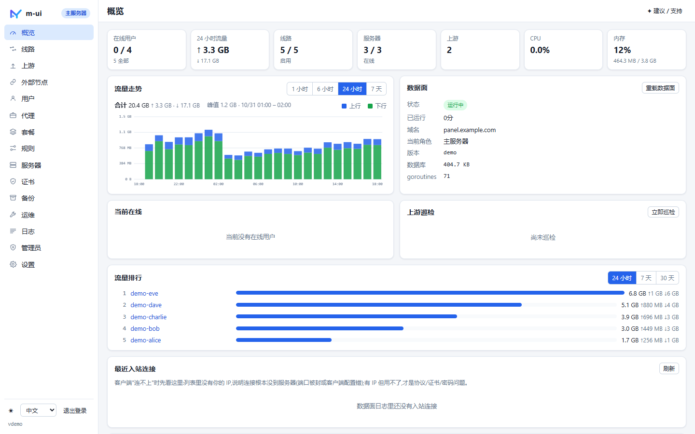
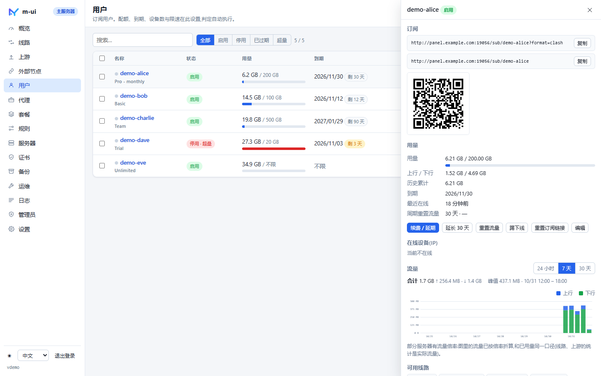
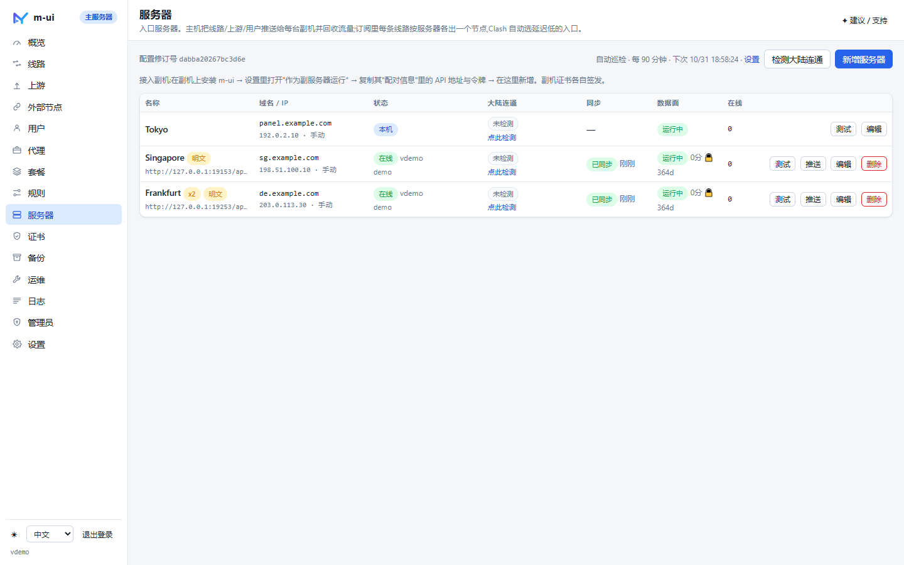
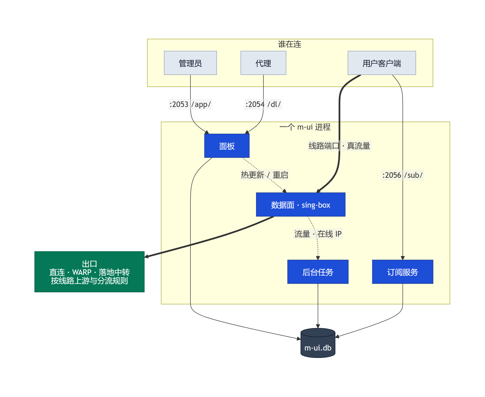
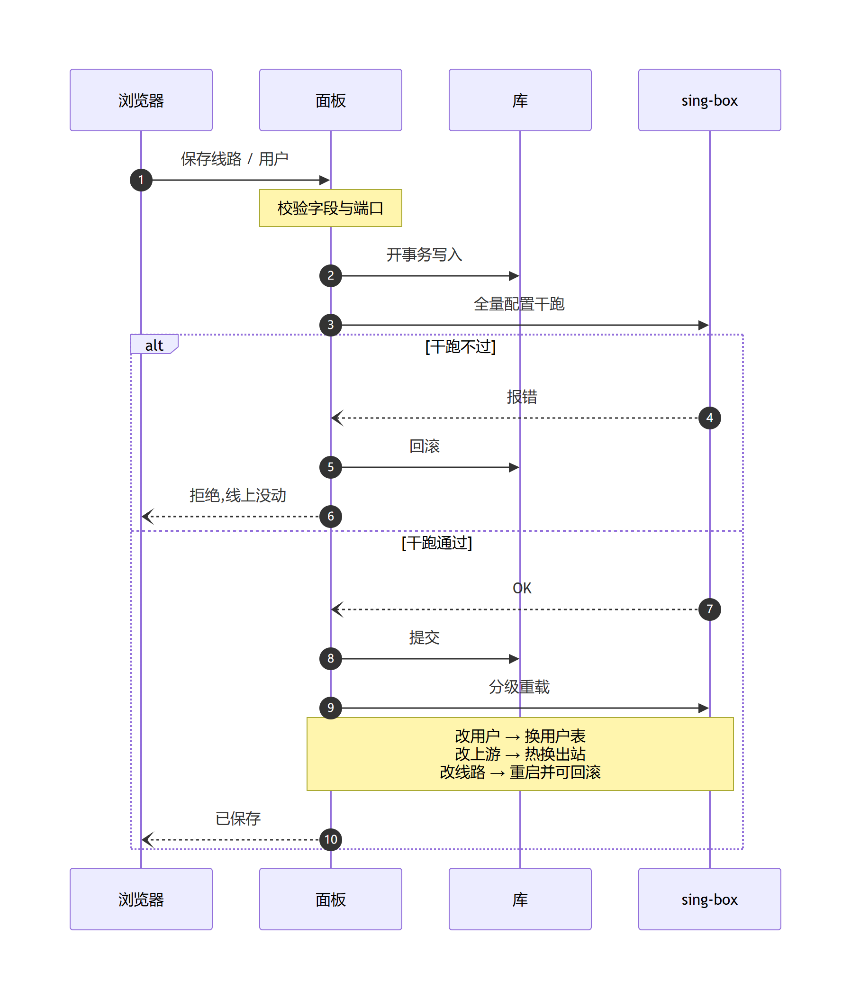
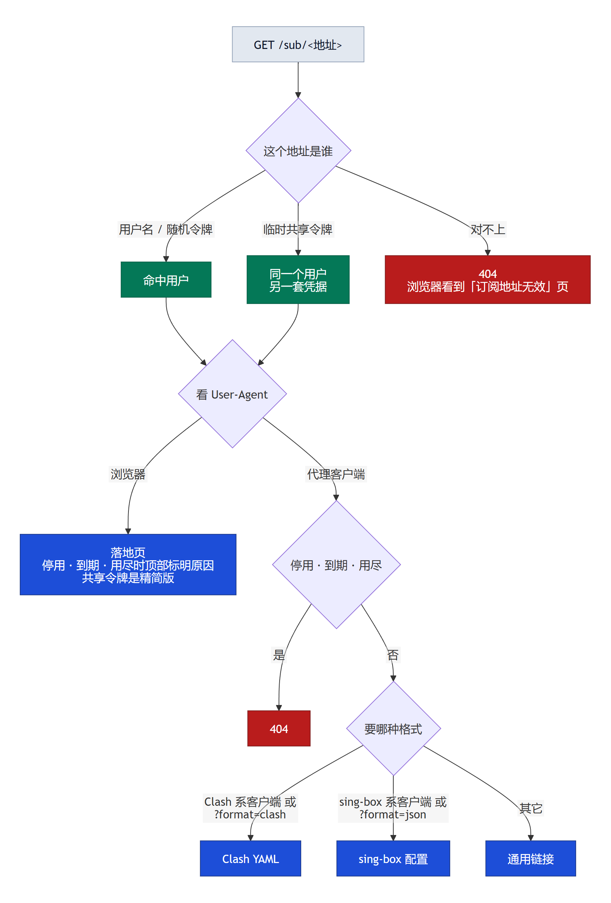
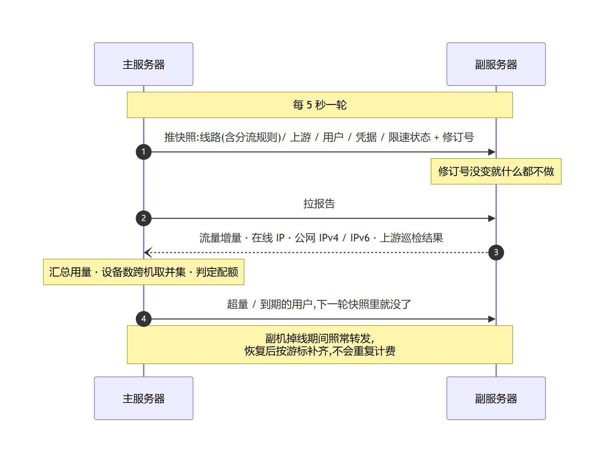
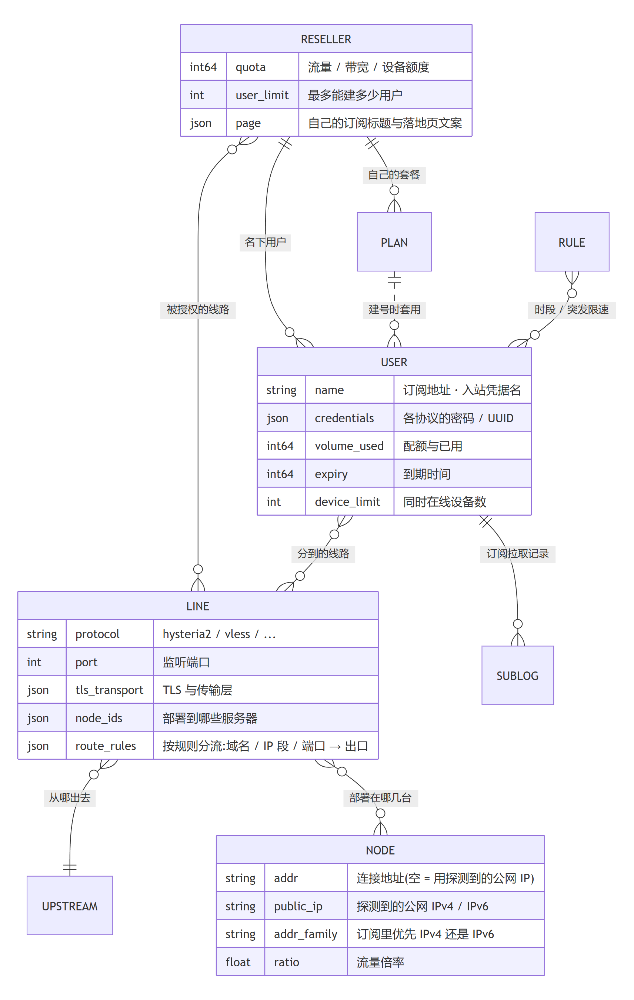

<p align="center"></p>
<h1 align="center">m-ui</h1>
<p align="center">内嵌 <a href="https://github.com/SagerNet/sing-box">sing-box</a> 的控制面,面向自托管与多服务器部署 · 一个 Go 二进制 · 线路代替 inbound/outbound/route · 每次应用先干跑、失败即回滚 · 一台主机管所有副机</p>
<p align="center"><sub>m-ui · <a href="https://github.com/Maoyangui">Maoyangui</a> 的 sing-box 面板 · Go · Linux · GPL-3.0 —— 与其它同名 “m-ui” 项目无关</sub></p>
<p align="center"><b>中文</b> · <a href="README.en.md">English</a> · <a href="https://maoyangui.github.io/m-ui/zh/">文档站</a> · <a href="https://maoyangui.github.io/m-ui/demo/">在线演示</a> · <a href="#架构">架构</a> · <a href="https://github.com/Maoyangui/m-ui/releases">下载</a></p>
<p align="center">
  <a href="https://github.com/Maoyangui/m-ui/actions/workflows/ci.yml"></a>
  <a href="https://github.com/Maoyangui/m-ui/actions/workflows/install-test.yml"></a>
  <a href="https://github.com/Maoyangui/m-ui/releases/latest"></a>
  <a href="LICENSE"></a>
</p>

---

**一行安装**(Debian / Ubuntu,root 运行):

```bash
bash <(curl -fsSL https://raw.githubusercontent.com/Maoyangui/m-ui/main/deploy/install.sh)
```

装完打开 `http://<服务器IP>:2053/app/`,默认账号 `admin / admin`(登录后到「管理员」页改掉)。**没有域名也能用**:一键自签证书 → 建线路 → 建用户 → 把订阅发出去,五分钟内完成。详见 [安装](#安装) 与 [快速上手](#快速上手)。

**先看看再装?** [在线演示](https://maoyangui.github.io/m-ui/demo/) 就是真实的面板界面跑在示例数据上:不用登录、没有后端,随便点,刷新即恢复。安装命令后面加 `--dry-run` 可以先看它会写哪些文件。

<p align="center"></p>

## 这是什么

m-ui 是一个自托管的代理面板:**一个二进制 + 一个数据库文件**,sing-box 直接内嵌其中。线路、用户、订阅、证书、备份、多台服务器,全在网页里管。

和常见面板的四点不同:

- **一条线路就是一件事** —— 入口协议 + 端口 → 从哪出去。不用再分别维护入站、出站、路由三张表。
- **保存不怕改错** —— 整份配置先交给 sing-box 干跑,过不了就进不了库;改用户、改上游是热更新,只有改线路才重启数据面,新配置万一起不来(比如端口被同机别的程序抢走)会自动回滚到上一份。
- **一主多副** —— 主机把线路、用户推给任意多台副机,收回流量、统一判定配额;订阅里每条线路按服务器各出一个节点,客户端自己挑延迟低的入口。
- **运维不用回终端** —— 证书签发续期、Cloudflare WARP、内核调优、备份还原、换机搬迁、Telegram 通知、两步验证、外部 API,都在面板里。

自己用、小团队用,或者要在好几台机器上统一管人,都合适。

## 功能总览

| 模块 | 内容 |
|---|---|
| 线路 | Hysteria2、AnyTLS、TUIC、Trojan、VLESS(Reality / Vision)、VMess、Shadowsocks(含 2022)、SOCKS、HTTP、Mixed;传输层 WS / gRPC / HTTPUpgrade / HTTP;Hysteria2 端口跳跃与伪装站点;Reality 握手目标一键检测;按服务器选择部署位置;按规则分流(域名 / IP 段 / 端口分给不同出口) |
| 上游 | VLESS / VMess / Trojan / TUIC / Hysteria2 / Shadowsocks / SOCKS 落地,粘贴分享链接导入;一键测延迟、定时巡检、故障 / 恢复告警;WARP 一键接入;**线路也能加为上游**(链式代理),参数跟着线路自动走;**上游组**:几条上游自动用最快能通的,挂了自动换 |
| 用户 | 配额(可到 0.1 GB)、到期(可设首次连接后才开始计时)、周期重置、同时在线设备数(按源 IP:IPv4 地址与 IPv6 /64 各自计数,跨服务器并集)、上下行限速;超量 / 到期自动禁用并踢线;批量生成、批量操作、CSV 导出。代理的用户归代理管,不混进主面板用户页 |
| 套餐 | 配额 / 时长 / 设备 / 限速 / 线路的模板,建号、续费(一次 N 期)、延期一键套用;换套餐可立即替换、叠加或按参考价折算,先预览再确认;可绑定限速规则,现有和以后的套餐用户都生效 |
| 代理 | 给代理分配线路、流量 / 设备 / 带宽额度与到期日,他在自己的面板(默认 2054,路径 /dl)里建号、建套餐;用量汇总到代理,超额 / 到期 / 停用即刻断其全部用户 |
| 订阅 | 通用链接、Clash、sing-box 三种格式,同一个地址按客户端自动给对的格式;Clash / sing-box 可自定义模板;外部节点可隐藏、改名、按关键词排除、测大陆连通;浏览器打开是落地页(用量、到期、一键导入、客户端下载、二维码、临时共享);订阅失效时给一页说明而不是空白 404;外部节点 / 外部订阅聚合;自签证书自动带 insecure |
| 多服务器 | 主机推送配置、回收流量、集中判定;每台服务器可设流量倍率;双栈服务器可按线路选 IPv4 / IPv6;副机失联 / 恢复告警;大陆连通检测(移动 / 电信 / 联通家宽测点,手动 + 定时,被墙告警);**设为主机**(一键把主机换到另一台,订阅地址不变)与**主机容灾**(主机挂了由备用接任,确认后或自动)|
| 证书 | 一台服务器可放多张证书:Let's Encrypt HTTP-01 / Cloudflare DNS-01 / 手动 DNS 签发(支持泛域名),到期前自动续期,热更新不重启;无域名时一键自签;线路默认、面板、订阅各选各的,每条线路也能单独选 |
| 备份 | 一个 zip 含数据库一致快照与证书;上传即整机还原;定时备份、轮转、推送 Telegram;换机向导 |
| 运维 | WARP 安装 / 启用 / 停用 / 卸载并验证出口;swap、内核参数 + BBR、文件句柄、NTP;限制系统日志(journald)占用 |
| 通知 | Telegram 与 Webhook:登录、用户到期 / 超量 / 禁用、上游故障、数据面停止、服务器大陆连通异常 / 恢复、每日报告(发送时点与日期都按面板时区);**Telegram 机器人**:手机上查用户、续期、重置流量、启停、要备份 |
| 观测 | 流量走势(按时段柱状,1h / 6h / 24h / 7d / 30d)、流量排行、在线用户与 IP、最近入站连接诊断、审计日志、订阅访问日志(后两者可各自设定自动清理天数)|
| 安全 | bcrypt 密码、CSRF 防护、登录冷却(同一来源连续失败即暂停尝试)、两步验证(TOTP)、外部 API 令牌;代理面板与主面板会话严格隔离 |
| 更新 | 面板自己发现新版本,侧栏版本号旁提示;一键更新 = 校验 SHA256 → 替换程序 → 重启,数据库、证书与所有设置不动 |
| 集成 | 外部 API(建号、续费 N 期、换套餐、启停、订阅地址;套餐操作可预览、带幂等键重试不重复加时),见 [docs/API.md](docs/API.md) |

<table>
<tr>
<td width="50%"></td>
<td width="50%"></td>
</tr>
<tr>
<td align="center"><sub>用户详情:订阅地址、二维码、用量、在线设备</sub></td>
<td align="center"><sub>服务器:一主多副,推送同步、在线状态一眼看完</sub></td>
</tr>
</table>

更多截图(线路、落地页、英文界面)在 [docs/screenshots](docs/screenshots)。演示数据全部是 example.com 与文档保留 IP。

## 架构

一个二进制里跑着四件事:**面板**(管理界面与 API)、**订阅服务**(客户端来拉配置)、**数据面**(内嵌 sing-box,真正过流量)、**后台**(统计、配额与限速规则判定、上游巡检、公网 IP 探测、大陆连通检测、日志清理、主副同步)。它们共用同一个 SQLite 文件,所以面板里点一下保存,订阅和数据面立刻看到同一份数据。

<sub>下面几张图由 [docs/diagrams](docs/diagrams) 里的 Mermaid 源文件渲染而成(网页和手机 App 看到的是同样的图);改了源文件运行 `node docs/diagrams/render.mjs` 重新出图。</sub>

### 一台服务器里有什么

<p align="center"><picture>
  <source media="(prefers-color-scheme: dark)" srcset="docs/diagrams/architecture-dark.png">
  
</picture></p>

> 端口和路径都能改;上面写的是默认值。面板与代理面板是同一套前端,靠会话里的作用域区分能看到什么。
>
> 每条线路有一个默认上游(直连、WARP 或某个落地中转),勾上按规则分流后,指定的域名 / IP 段 / 端口可以走别的出口或直接拦掉;纯 IPv6 机器的直连线路还会把 1.1.1.1、8.8.8.8 这类公共 DNS 改连它们的 IPv6 地址。外部服务都是可选的:GitHub(检查更新)、v2fly 域名库(查应用域名)、Cloudflare / ipify(探测本机公网 IPv4 与 IPv6)、Globalping(大陆连通检测、主机容灾的境外见证)、Cloudflare API(签证书、主机容灾自动改 DNS,都要自己填令牌)、Telegram(通知);连不上只影响对应那一项。

### 保存一次改动,发生了什么

面板从不直接去改运行中的 sing-box —— 先让 sing-box 自己把整份新配置解析一遍,通过了才落库、才动数据面。

<p align="center"><picture>
  <source media="(prefers-color-scheme: dark)" srcset="docs/diagrams/apply-dark.png">
  
</picture></p>

### 一次订阅请求怎么走

<p align="center"><picture>
  <source media="(prefers-color-scheme: dark)" srcset="docs/diagrams/subscription-dark.png">
  
</picture></p>

> 三种格式里的节点都是同一套来源:**用户已分配的线路 × 该线路已部署的服务器**,再拼上外部节点与外部订阅。所以加一台服务器,所有人的订阅里自动多出对应节点。分配也可以细到入口:一条线路部署在几台服务器上就是几个入口,给用户 / 套餐 / 代理授权时可以只勾其中某台的,订阅里就只出拿到的那些。

### 主服务器与副服务器

主机算账、推配置;副机只管转发,不自己判定配额,所以断联时也不会误伤用户。

<p align="center"><picture>
  <source media="(prefers-color-scheme: dark)" srcset="docs/diagrams/sync-dark.png">
  
</picture></p>

### 数据模型

<p align="center"><picture>
  <source media="(prefers-color-scheme: dark)" srcset="docs/diagrams/data-model-dark.png">
  
</picture></p>

### 后台节奏

| 周期 | 做什么 | 代码 |
|---|---|---|
| 5 秒 | 主机推快照给副机、拉回流量与在线 IP | `hub/` |
| 10 秒 | 从数据面取流量与在线连接,按用户 / 线路 / 上游写入统计 | `jobs/` |
| 10 秒 | 判定限速规则(时段 / 突发),命中的生效状态随下一次快照推给副机 | `rules/` `jobs/` |
| 1 分钟 | 判定配额、到期、周期重置,该禁的禁、该踢的踢;数据面看门狗 | `jobs/` `monitor/` |
| 10 分钟 | WAL 检查点,让运行中的 .db 随时可安全复制 | `runner/` |
| 10 分钟(可设) | 上游巡检:各机只测自己线路用到的上游,故障 / 恢复告警 | `monitor/` |
| 30 分钟(可设) | 主机刷新外部订阅,结果随快照给副机 | `runner/` |
| 90 分钟(可设) | 主机做大陆连通检测(Globalping 大陆测点,测 IPv4;订阅里有走 IPv6 的线路时,同一轮从境外测点测 IPv6 入站) | `reach/` |
| 1 小时 | 探测本机公网 IPv4 / IPv6(连续 3 轮测不到才认为没有);用户到期与用量预警;按保留天数清理统计与日志 | `runner/` `monitor/` `jobs/` |
| 6 小时 | 查一次有没有新版本(只查,不自己更新;直连 GitHub 不通时经本机 WARP) | `selfupdate/` |
| 24 小时 | 从 GitHub 下载一次空文件,用来统计在线设备数(不带标识,可关)| `runner/` |
| 启动 3 分钟后,之后每 1 小时 | 证书续期检查:进了续期窗口的自动续,失败按退避重试;不能自动续的按天提醒 | `runner/` |
| 每天 | 日报;定时备份(设定的钟点) | `monitor/` `runner/` |
| 1 小时 | 按各自的保留天数清理流量时序、订阅访问日志、审计日志;48 小时前的分钟级流量样本并成小时桶 | `jobs/` |
| 按设置(默认 10 分钟)| 巡检上游:每台只测自己线路用到的那些,结果汇总回主机 | `monitor/` |
| 启动 3 分钟后,之后每 1 小时 | 证书续期检查(续期后 sing-box 自动换证书,不重启;结果记在每张证书上,重启不丢) | `runner/` |
| 每天 | 日报 | `monitor/` |

### 代码结构

| 目录 | 职责 |
|---|---|
| `web/` | 面板与 API、代理面板与作用域、外部 API、内嵌前端(零构建 ES 模块) |
| `sub/` | 订阅三种格式、落地页、客户端下载页、临时共享 |
| `render/` `core/` | 线路 → sing-box 配置的渲染与干跑校验;内嵌数据面、流量与连接跟踪 |
| `hub/` | 主副机快照推送、流量回收、在线聚合 |
| `runner/` | 进程编排、三级重载与回滚、证书、备份、外部节点 |
| `jobs/` `monitor/` | 统计、配额判定、清理、上游巡检与告警 |
| `rules/` | 限速规则:时段 / 突发判定、生效状态、与用户限速的叠加计算 |
| `database/` | 模型、SQLite 打开与迁移 |
| `selfupdate/` `deploy/` | 版本检查与就地更新、安装脚本 |

## 安装

### 系统要求

- Linux amd64 或 arm64,systemd(Debian / Ubuntu / Rocky / CentOS 等均可,推荐 Debian 11+ / Ubuntu 20.04+;安装脚本依赖 systemd,Alpine 这类没有 systemd 的系统不支持)
- root 权限
- 放行端口:面板 `2053/tcp`、订阅 `2056/tcp`、启用代理面板时再加 `2054/tcp`,以及你创建的线路端口(TCP 或 UDP 视协议而定)。签发证书用 HTTP-01 时还需要 `80/tcp` 可达

### 一键安装(推荐)

```bash
bash <(curl -fsSL https://raw.githubusercontent.com/Maoyangui/m-ui/main/deploy/install.sh)
```

不是 root 用户时用管道形式:

```bash
curl -fsSL https://raw.githubusercontent.com/Maoyangui/m-ui/main/deploy/install.sh | sudo bash
```

脚本会自动识别架构,从 GitHub Releases 下载最新版,装到 `/usr/local/bin/m-ui`,数据放在 `/etc/m-ui/`,并注册 `m-ui.service` 开机自启。安装结束会打印面板地址与默认账号。

指定版本或离线安装:

```bash
bash install.sh v0.2.0                          # 指定版本
bash install.sh ./m-ui-linux-amd64.tar.gz       # 本地文件(Releases 里的压缩包或裸二进制)
bash install.sh https://.../m-ui-linux-arm64.tar.gz   # 任意下载地址
```

### 首次登录

- 面板地址:`http://<服务器IP>:2053/app/`
- 默认账号:`admin` / `admin`

登录后顶部会一直提示修改默认密码,请到 **管理员** 页立即修改。改端口、路径、账号也可以在 SSH 里执行 `m-ui` 用菜单完成。

### 升级

```bash
m-ui            # 菜单选 10 "更新到最新版"
```

或重新执行一键安装脚本。升级只替换二进制并重启,数据库、证书、备份都不动。

有副机时**先升副机,再升主机**:主机用到新功能后,版本不够的副机会整份拒收同步、按旧配置继续服务,直到它升级;主机容灾的备用比主机旧时保留名次,但收不到新的数据副本。面板、代理面板或外部 API 挂在反向代理(Nginx、Caddy 等)后面的:v0.7.17 起外部 API 令牌错 10 次会暂停这个来源 5 分钟(面板登录本来就有),不设的话所有请求的来源都是反代自己,一个人连错就把大家一起挡住,升级后到 设置 → 面板 → **受信任的反向代理** 填上反代的地址(同机反代填 `127.0.0.1, ::1`,见 [docs/API.md](docs/API.md))。升级到 v0.7.17 后**主机容灾默认关闭**,要用就在主机的 设置 → 主机容灾 里打开(见[主机容灾与设为主机](#主机容灾与设为主机));不打开时一切照旧。另外 v0.7.17 起 sing-box 订阅也按线路出测速组,外部订阅里和线路同名的节点改叫「X 2」,客户端里选着它的用户要重新选一次(见[外部节点](#外部节点))。

### 卸载

`m-ui` 菜单选 14,可选择是否同时删除 `/etc/m-ui` 数据目录。

## 快速上手

登录后概览页有一份**快速开始**清单,按顺序做完就能用:

1. **域名**(可选):设置 → 面板 → 域名。把域名 A 记录解析到服务器 IP。
2. **证书**:证书页填域名,一键签发 Let's Encrypt;没有域名就点"生成自签证书"填服务器 IP。面板、订阅、数据面共用这张证书,以后自动续期。
3. **线路**:线路页新增,选协议(推荐 Hysteria2 或 AnyTLS)、端口、上游(默认直连),保存。
4. **用户**:用户页新增,勾选可用线路,或直接套用套餐。
5. **分发订阅**:用户列表复制订阅链接发给用户,或让用户在浏览器打开落地页扫码 / 一键导入。

没有域名也能用:自签证书 + IP 地址,订阅会自动带上"允许不安全证书",客户端无需额外设置;之后有了域名再签发正式证书,用户刷新一次订阅即可。

## 功能说明

### 线路

- 一条线路对应一个入口端口。端口在所有服务器上一致,主机负责渲染并下发到每台副机。
- **上游**决定流量从哪出去:直连、WARP、或任意一个已添加的落地节点(中转)。勾上**按规则分流**可以让指定的域名、IP 段、端口走别的出口(或拦掉),其余走这里选的上游。旁边的查询框填应用名(抖音、netflix、chatgpt……)点「查域名」,由服务器去公开的域名库(v2fly)里查,每个应用加成一条带应用名的规则,域名可以再改,出口在规则里选。
- **部署到**:默认所有服务器;也可以只部署到某几台,例如给某台副机建一条它专属的线路。
- Hysteria2 可填**端口跳跃范围**(如 `20000-30000`),服务器用 nftables / iptables 把这段 UDP 转到线路端口,客户端在范围内随机换端口,规避运营商对单端口 UDP 的限速。
- Hysteria2 可填**伪装站点**:别人探测这个端口时看到的是这个网站,不是一个报错的代理。新建线路默认 `https://www.bing.com`,留空就是不伪装。
- Reality 的握手目标旁边有**检测**和**帮我挑**:从主服务器真连一次,看 TLS 1.3、H2、X25519 是否都支持、延迟多少;「帮我挑」把常见大站测一遍,按延迟列出前几个,点一下填入。线路部署在别的服务器时,延迟只作参考。
- 保存时整份 sing-box 配置先干跑校验,失败的改动不会落库。

> 新建线路时端口会自动填一个可用的五位端口(仍可改):它避开已有线路与面板 / 订阅 / 代理面板端口,并在服务器上真的监听一次确认空闲。手填的端口同样会检查——**同机跑着别的项目也算**:保存前会试着监听一次,被 nginx、其它面板之类占着就直接拒绝(端口没改的编辑不检查,那时占着它的正是本机运行中的数据面)。冲突是双向拦截的:线路不能用面板端口,面板 / 订阅 / 代理面板也不能改成线路正在用的端口或别的程序占着的端口——保存时就报错,不会等到重启才发现起不来。

### 上游

- 可视化编辑或直接粘贴 `vless://`、`hy2://`、`ss://` 等分享链接导入。
- 一键测试延迟(经上游访问测试地址),定时巡检;连续失败发 Telegram 告警,恢复时再通知。
- **巡检在真正用这条上游的机器上做**:每台服务器只测自己线路用到的上游,结果汇总回主机,上游页一行里并排显示各服务器的延迟。没有线路使用的上游标「未使用」,不测也不告警;告警会点名是哪台机器上不通。有故障或数据过期时行尾才出现展开箭头,点开是每台的状态、检查时间与完整报错。
- 运维页启用 WARP 后会自动出现名为 `warp` 的上游,线路选它即可走 WARP 出口。
- **线路加为上游**(链式代理):线路页点「→」,或上游页「把线路加为上游」,选线路和它在哪台服务器上的入口。参数跟着线路自动走,线路改端口、换协议都不用管;用的是专用凭据,不占用户配额,流量只算一次;成环、线路被删、入口服务器被删都会拦下或标出来。副机要 v0.7.16 及以上才会下发这种配置。

- **上游组**:上游页「新增上游组」,选两条以上上游,线路选这个组。每 30 秒测一次,走延迟最低的那条能通的,挂了自动换,并断开旧连接让应用马上重连;现用的这条只要没比最快的慢 300 毫秒以上就不换,免得来回切。上游页写明每台服务器现在走哪一条;成员有一条通组就算通,成员自己故障照常告警。改成员、改组都是热换,不重启数据面。

### 外部节点

把别处的节点并进你的订阅:一条分享链接,或一整个外部订阅(机场、中转)。主机定时抓取(间隔可设),分配给用户后出现在该用户订阅里本站节点之后,可加统一前缀便于区分。名字和本站节点、或这个用户的任一条线路撞名时由外部节点让名,后面加序号(「香港1」→「香港1 2」),加前缀可以避开。线路名不论这次出没出入口组(用户在这条线路上只拿到一台、线路只部署在一台、服务器停用到只剩一台或不剩)都留给本站,外部节点的名字不随线路出不出组来回变,选着线路入口组的客户端也不会在组不出时被落到同名的第三方节点上。升级到 v0.7.17 时,外部订阅里和用户某条线路同名的节点会这样改名一次(Clash 与 sing-box 订阅都是),客户端里选着它的要重新选「香港1 2」;线路改了名时同理。支持 base64 / 明文链接列表、Clash YAML、sing-box JSON;抓取时先以 Clash Meta 身份要全量列表(有的面板按客户端发不同子集,通用身份只能拿到一两种协议),内容里没有节点才换通用身份;抓取失败(超时、限流、4xx / 5xx)保留上次成功的内容,列表上写明错误和上次成功的时间。

列表里点开一条外部订阅,能看到它解析出的全部节点:每个节点的完整参数(服务器、端口、SNI、UUID、密码、传输方式等)和分享链接;可以从每台启用的服务器出发真连测延迟(结果按服务器分列,代表作为上游时的可用性;默认只测会输出的节点,可随时停止;协议转不成本站出站的标「不支持」,和「不通」分开),也可以勾选几个、各起一个名字直接添加为上游——走和手动新增上游同一套校验,重名报错不改名。

展开后还能管这个订阅怎么输出给用户:单个节点可隐藏、可改名,按名字和节点指纹(地址、端口、密码等)一起记,机场改名、调换顺序、重新编号后仍认得,同名的节点也能分开管;剩余流量、到期这类信息节点的名字每次刷新都会变,建议用「排除关键词」把名字带「官网」「到期」「剩余流量」的节点一次去掉,以后新增的也管用。勾选节点可以从大陆三网测一次是否被墙:hysteria2、tuic 等 UDP 协议只能 ping 地址;国内中转入口大陆通、香港不通算正常。

### 用户与套餐

- 每个用户:配额、到期、周期重置(如每 30 天清零)、设备数、限速、备注、可用线路(可细到某台服务器上的入口)、可用外部节点。
- 订阅地址泄露了就「重置订阅链接」(列表「更多」与详情里都有,代理面板同样):地址换成新的随机令牌,全部协议凭据重新生成,临时共享一并收回;旧地址、旧凭据在所有服务器上立即失效,已连的设备被断开。
- 超量或到期自动停用并踢下线,列表里标出原因(超量 / 到期 / 手动);重置流量、延长到期或续费后自动恢复。手动停用的不会因重置流量、「延长 30 天」或周期重置恢复;但用套餐续费 / 延期 / 换套餐(含批量「套用套餐」和外部 API 的 `/plan`)会把他一并启用,面板里执行前会提示。
- 配额可以写小数(0.1 = 约 100 MB),用户和套餐都一样。
- 到期可以设成**首次连接后 N 天**:第一次产生流量时才开始计时,适合发卡、试用。已经在计时的用户续费照常顺延。
- 套餐是模板:建号时选套餐一键填好;续费 = 再套一次(用量清零、到期顺延);延期 = 保留用量只顺延到期;都可以一次续 N 期(季付、年付按月计填 3、12)。用户记着自己的套餐,套餐页显示人数,点进去看是谁;老用户升级时按操作记录和完全相同的额度补上归属,对不上的留空,不瞎猜。
- 换套餐(用户详情或「更多 → 换套餐」):**立即替换**从现在起算、旧的作废;**叠加**保留剩下的时间(和一次性流量)再加 N 期(已经过期的不结转;新套餐不限期或不限量时,原来有限的到期或配额照旧保留,不会悄悄变成不限);**按价值折算**按两个套餐的参考价把旧订阅剩余的价值折成新套餐的时长(参考价不收钱、不给用户看,不填就不能折算)。改动时实时预览变更前后的对比,会立刻超量或到期提前的要勾「仍然执行」;每次续费、换套餐(包括外部 API 改用户时顺带套用套餐)都记进用户的「套餐记录」。代理面板同样可用,只能换成代理自己的套餐。
- 编辑套餐时可以勾选限速规则:这个套餐的用户(现有的和以后的)都跟着走。
- 批量:按前缀批量生成、勾选后批量启停 / 延期 / 重置 / 删除,导出 CSV。
- 用户抽屉:实时在线设备(每个 IP 标出正在使用的线路与服务器)、24h / 7d / 30d 流量图、订阅链接与二维码、踢线(所有服务器一起断;hysteria2 / TUIC / AnyTLS 连整条会话一起关,不能靠已鉴权的会话继续开新流)。

### 规则

- 给用户加临时限速,两种:**时段限速**(每周指定几天的某个时间段,按面板时区,支持跨午夜)和**突发限速**(最近 N 分钟内上下行合计达到 X GB 就限速 M 分钟,到期自动解除,再次达到再次限速)。
- 目标可叠加:全部用户(含以后新建)、某个套餐的用户(含以后套用的)、某个代理名下全部用户(含以后新建)、逐个勾选;勾选器按主面板 / 各代理分组,切换分组不丢勾选。
- 规则由主机每 10 秒判定,命中写一条生效状态,随快照下发副机;主副机都把状态叠加到用户自己的限速上。多条同时命中取最严;开着「不超过用户自己的限速」(默认)的规则不会高于用户自己的限速,关掉后规则值直接覆盖,可用于在特定时段放宽。同一用户可挂多条突发规则,各自独立触发与计时。
- 改限速对在线连接立刻生效(令牌桶原地改速率),不用等重连——这也修掉了以前"改用户限速要等重连"的旧行为。
- 用户列表标出「限速中」与规则名,详情里列出每条生效中的限速与剩余时间;触发与解除记入操作审计,可选 Telegram 通知。规则限速只在面板与外部 API 可见,**不显示在用户的落地页**。

### 代理

把一部分销售交给别人做:主面板「代理」页新建代理,勾选他能用的线路,给一份流量额度、一个设备池和带宽池,还可以限制他最多建多少个用户。

- 代理面板:默认 `https://<域名或IP>:2054/dl/`,端口、路径、证书在 设置 → 代理面板 里改(证书留空与主面板共用)。
- 登录名就是代理名称,**新建的代理没有密码**:第一次用名称登录后必须先设置密码,之后可自行改密码、开两步验证。忘记密码由主面板「重置密码」清空,他下次登录时重设。
- 代理在自己的面板里只看得到自己的用户:建号只填名称(订阅地址是一串随机令牌,link / Clash / sing-box 三种格式与二维码都照常),可分配线路(只限主面板授权给他的,授权可以收窄到某台服务器)、流量、到期、设备、限速,也能续费、重置、踢线、批量操作、看用量曲线与在线设备。**套餐也是各管各的**:代理只看得到、也只能用自己建的套餐。
- 额度:流量按**全时用量**计(代理自己重置、续费、删号都洗不掉,只有主面板"重置流量"能清零);设备数与上下行带宽是**运行时的池**——代理给单个用户填多少都行,但名下所有用户同时在线的设备总数不超过设备池(跨服务器算并集,池满只拒新设备),合计速率不超过带宽池(每台服务器各一份);到期日、停用、超额任意一条踩线,他名下用户立刻从数据面撤下、订阅返回 404。
- 代理可以配自己的**订阅标题**(客户端里显示的名字)与落地页文案(标题、logo、公告、客服),留空都跟随主面板;也能单独关掉自己的订阅页与临时共享。
- 新建的代理有 24 小时"认领窗口":这段时间内在代理面板填代理名、**密码留空直接点登录**,进去后必须先设好密码;过期未认领就得由主面板再点一次"重置密码"重开窗口,避免账号一直敞着。
- 代理的用户不出现在主面板的用户页与 CSV 导出里;要看就进代理详情:一行一个用户,列出用量、到期、在线设备,展开能看到每个 IP 走的是哪台服务器的哪条线路,也能直接复制他的订阅地址。

### 订阅

- **一个地址就够**:`https://<域名或IP>:2056/sub/<用户名>`。客户端来拉时按 User-Agent 给它能用的格式 —— Clash Verge / mihomo / Stash 拿 Clash,SFA / SFI / sing-box 拿 sing-box,NekoBox、Throne、Hiddify、v2rayN、Shadowrocket、Quantumult X、Loon、Karing、nextin 等拿通用链接;认不出的按通用链接给。老内核 Clash(CFW / ClashX / CFA)不会收到它认不出的协议和 SS-2022,写了 `?format=clash` 也一样;要强制按新内核给就写 `?format=mihomo`。想强制某种格式就加 `?format=`(大小写都认)。设置 → 订阅格式与模板 可以关掉自动识别。
- 设置 → 订阅的"用用户名作订阅地址"默认开着;关掉后**新建**用户的订阅地址改成一串随机令牌(用户名只作名称,地址猜不到),已有用户不受影响,代理建的用户一律是随机令牌。
- Clash:在链接后加 `?format=clash`,适用于 mihomo / Clash Verge / Stash 等;每条线路生成一个按延迟自动选择的入口组。
- **自定义模板**:设置 → 订阅 可以给 Clash 和 sing-box 各写一份模板,节点和分组由面板填进去;模板写错保存时就报错。有「填入默认模板」可以照着改。
- sing-box:在链接后加 `?format=json`,输出完整的 sing-box 客户端配置(TUN + 分组 + DNS + 分流),SFA(Android)/ SFI(iOS)/ 桌面版直接作为远程配置导入,落地页有一键导入。部署在多台服务器上的线路和 Clash 一样各出一个按延迟自动选择的入口组(v0.7.17 起;组名就是线路名,节点名不变)。
- 客户端里显示的订阅名来自 设置 → 订阅 的"订阅标题"(留空依次回落到订阅页标题、备注、用户名),中文按标准方式编码后随 `Content-Disposition` 与 `Profile-Title` 两个响应头发出。nextin、sing-box 这类每次更新都读标题的客户端刷新即可;Shadowrocket 与 Clash Verge 是在**添加订阅那一刻**定名的,之后不改名——用落地页的一键导入按钮添加(会把标题一起带上),或让用户删掉重加。
- 浏览器打开链接显示落地页:用量、到期、各客户端一键导入、二维码、自定义 logo、公告与客服信息。
- 落地页 logo:设置 → 订阅页 上传(代理在自己面板的 账号 → 订阅页 传自己的),上传即生效;PNG、JPEG、GIF、WebP、SVG 都行,浏览器先缩到 480×160 以内并转成 PNG(不超过 64 KB)再传,服务端只收 PNG / JPEG / GIF。代理没传用主面板的,都没传用内置 logo;也用作浏览器标签图标,随快照同步到副机、跟着备份走。落地页跟随访客的深色模式,深色时给上传的 logo 垫一块浅色底(透明底的深色 logo 也看得见),设置里的预览并排显示浅色、深色两种效果。
- 公告与联系方式里可以写链接:`文字(https://…)` 或 `[文字](https://…)` 在页面上只显示文字,括号、方括号半角全角都行(中文输入法打出来的 `【文字】（链接）` 也认)。`文字(链接)` 的括号前空一格也行;链接文字从括号往前取,到最近的标点、上一个链接或前面自动识别出的地址 / @用户名 / 号码为止。`Tg: @用户名`(Telegram、电报、飞机同样,前面紧挨着汉字也认)和 `WhatsApp: +号码`(WA、WS 同样)会自动变成可点的链接;裸写的 `https://…` 地址本身就是链接。只认 http(s)、tg、mailto、tel 链接,别的照原样显示成文字;字号不变。文字里有 `/`、或链接里有括号时用 `[文字](链接)`。
- 客户端下载:落地页"一键导入"右上角有个下载箭头,新开一页按系统给下载入口 —— iOS / iPadOS / Apple TV(Nextin,附切区说明)、Android / Android TV(Clash Meta for Android)、Windows / macOS / Linux(Clash Verge Rev,Linux 另给 FlClash 的 AppImage)。每个系统都有官方直链、国内镜像与"全部版本"入口。这一页的地址和页内「返回订阅页」都带着本人的订阅地址,不要转发;想让别人装客户端,转发各客户端的官网或发布页。代理的用户看到的是同一页。
- 用完、到期、被停用(或所属代理额度用尽 / 到期)的用户,浏览器里仍能打开自己的落地页:顶部标出原因、下次重置日与该看的联系方式(代理的用户看代理自己配的那套);只是客户端从这一刻起拉取拿到 404,线路入站也不再放行。地址对不上任何人时浏览器看到「订阅地址无效」页,客户端同样纯 404。
- 订阅端口按来源 IP 限流(默认每分钟 120 次,设置 `subRateLimit`,超出返回 429),对不上任何人的地址按 IP 聚合记一条访问日志,扫描器刷不爆日志表。
- 临时共享:用户可在落地页生成一条随机地址临时给别人用,每人一条。共享地址给的是同一批节点但**另一套凭据**,在数据面挂在本人名下——流量、设备数、限速、到期都算本人;取消(或重新生成)会立即撤下这套凭据并断开连接,借用者已经拉走的节点也随之失效。共享地址用浏览器打开也是一张落地页(精简版:临时共享标识、选购、公告、一键导入、订阅地址、节点,不含本人的用量、到期与账户信息),客户端拉到的仍是订阅。设置 → 订阅页 可整体关闭。
- 节点地址默认用**服务器 IP**、域名只作 SNI,避免客户端本地 DNS 被污染导致连不上;可在设置里改为域名。
- 多服务器时每条线路按服务器各出一个节点,名称后缀为服务器名;流量倍率不为 1 的服务器会带 `x2` 之类的标记。

### 多服务器

任意数量的副服务器,接入步骤:

1. 副机同样安装 m-ui,登录后 **设置 → 角色** 勾选"作为副服务器运行"。
2. 副机 **设置 → 配对信息** 复制 API 地址与令牌。
3. 主机 **服务器** 页新增:名称(如"香港",作为订阅节点后缀)、域名、API 地址、令牌,可选跳过证书校验(副机自签时;第一次连上会记住它的证书指纹,之后指纹变了就拒绝,重签证书后点「重置指纹」)。
   API 地址是 `http://` 时,令牌与全部用户凭据明文过公网(服务器页标「明文」):建议副机面板开 HTTPS(自签即可),或让副机端口只对主机开放。
4. 几秒内主机完成推送并显示"已同步"。

工作方式:主机每几秒比对快照,有变化就推给副机;同时从副机拉回流量账本、在线 IP、运行状态与证书剩余天数。配额只在主机判定,禁用用户 5 秒内传到所有副机。副机失联超过 1 分钟告警一次,恢复再通知;离线期间副机继续用最后一份配置服务用户,到期的用户与代理按本机时间自己停掉。

每台服务器可设**流量倍率**(含主机自己):经该服务器的流量按倍率计入用户用量,比如给贵的线路设 2 倍。用户的已用量、用户详情和落地页的流量图都是折算后的数,账对得上。副机的落地页只看得到经过它自己的流量,所以不显示流量图。

**连接地址与 IPv4 / IPv6**:订阅里每台服务器给的是它的公网 IP(域名只作 SNI)。每台同时探测 IPv4 和 IPv6,默认用 IPv4;服务器编辑里「自动地址用」可改成 IPv6,选的那个没探测到就用另一个;填了连接地址就用填的。**双栈服务器**在线路表单里还能按线路单独选 IPv4 或 IPv6,没选的跟服务器设置。订阅里的节点地址设成"域名"时,没单独选的线路给域名、走哪个由客户端解析决定(服务器的「自动地址用」不起作用),单独选了的线路照样直接给 IP。

**IPv6 线路**:线路入站一律监听 `::`(双栈,IPv4 也收),选 IPv4 还是 IPv6 只影响订阅给哪个地址;内核整个关了 IPv6(启动参数 `ipv6.disable=1`)时自动改听 `0.0.0.0`。IPv6 连不上多半在环境:探测到的 IPv6 可能只是出口地址(WARP、NAT66、仅出站网关),云安全组要为 `::/0` 单独放行(hysteria2 / tuic 走 UDP,其余 TCP),`ip6tables` / nftables / ufw 也要放行 IPv6,客户端所在网络要有 IPv6。线路表单选了 IPv6 时会列出这几条自检要点;能不能入站以服务器页的 IPv6 入站检测为准(Azure 这类 1:1 NAT 的公网 IPv6 不在网卡上,照样能用)。在服务器上抓包时注意 tcpdump 在本机防火墙之前抓包,也在端口跳跃的转发之前(开了端口跳跃的 hysteria2 要连跳跃范围一起抓:`tcpdump -ni any "ip6 and (udp port <端口> or udp portrange <起>-<止>)"`,只按线路端口抓多半看不到):一个包都没有是安全组、路由或客户端网络的问题;只有进来的包没有回包(SYN 反复重传、UDP 只进不出)是本机防火墙拦了或回包走错了出口——hysteria2 开了混淆的先核对客户端的混淆密码,密码不对或客户端没开混淆时服务端也是一声不响地丢包;有来有回还连不上才是证书、SNI、密码或设备数的问题。已知上游限制:hysteria2 开了混淆(obfs)时混淆层拿不到收包的目的地址,有多个 IPv6 地址的机器上回包可能用错源地址;这种机器上走 IPv6 的 hysteria2 线路不要开混淆,或把连接地址填成内核默认用来发包的那个 IPv6(`ip -6 route get 2001:4860:4860::8888` 里的 `src`)。

**大陆连通检测**:服务器页的「大陆连通」一列,由主机借 [Globalping](https://globalping.io) 公共测试网络,从大陆移动、电信、联通的家庭宽带测点(不含机房测点)连每台服务器,香港测点作对照。大陆三网都连不上、香港能连 → 判为被墙;再补测一次 ping,分清是整个 IP 被墙(换 IP)还是只有端口被封(换端口)。测的是这台服务器上订阅里走 IPv4 的第一条 TCP 线路的端口(走 IPv6 的线路——包括自定义地址写成这台自己 IPv6 的——不拿来测 IPv4 地址;自定义地址是国内中转、CDN 之类别处的 IPv6 时,用户连的是中转,线路端口照样拿来测这台的 IPv4);走 IPv4 的只有 hysteria2 / tuic 这类 UDP 线路时测订阅或面板端口,只能看出 IP 有没有被墙,面板端口只对主机放行、香港测点也连不上时记"无可测端口"(灰色、不告警);副机的线路在订阅里都走 IPv6 时这一项不测,同样记"无可测端口",以前测出的结论不再挂着;主机照测订阅地址的 IPv4 和订阅端口——用户刷新订阅连的是订阅地址,它的 IPv4 被墙时大陆用户拿不到新节点;订阅地址是域名时在主机上解析,测解析出来的 IPv4——订阅地址本身是 IPv6、或是没有 A 记录(只有 AAAA)的域名时才记"无可测端口"。服务器根本没有 IPv4(只上报了 IPv6,连接地址、域名也解析不到 IPv4)时,线路走中转、订阅给域名也一样记"无可测端口",主机副机都是;解析域名出错(超时之类,不是没有记录)时算没测成。只测 IPv4 是因为大陆的家庭宽带测点大多没有 IPv6,拿它们测 IPv6 会把正常的服务器误判成被墙。可手动检测,也会定时巡检(默认每 90 分钟,**设置 → 大陆连通检测**里可改或关闭),发现异常先隔两分钟复测,仍异常才发 Telegram,恢复时再通知。检测时服务器地址会发给 Globalping;免登录额度每小时约 250 个测点次(测一台约 15 个,有走 IPv6 的线路的再加约 4 个;额度先保大陆检测),填免费令牌可提高。

**IPv6 入站检测**:订阅里有走 IPv6 的线路(服务器默认给 IPv6、线路在这台单独选了 IPv6,或自定义地址写成这台自己的 IPv6——手填的连接地址或探测到的 IPv6;中转、CDN 之类别处的 IPv6 写了 `node_id` 也不算,不拿去测)时,同一轮再从 Globalping 境外支持 IPv6 的测点(欧洲、北美各 2 个,约 4 个测点次,用大陆检测剩下的额度)连它在订阅里的 IPv6 地址和第一条走 IPv6 的 TCP 线路端口:都连不上多半是安全组没放 `::/0` 或 `ip6tables` 拦了。结果显示在服务器页和线路页,线路页按线路说话:被测的那条线路显示通 / 不通,别的 TCP 线路标"未测到此端口"(每个端口要各自放行,别的端口通不代表它通),hysteria2 / tuic 标"未测(UDP)",只能在服务器上抓包确认(`tcpdump -ni any ip6 and udp port <端口>`,开了端口跳跃的连跳跃范围一起抓)。它只说明包能不能到服务器,不代表大陆的 IPv6 线路好用;这次没有可用测点时保留上一次的结论。不另起定时,不发 Telegram;主机的状态接口另给不通的服务器(`v6Bad`),供概况页提示。

> 删除一台服务器时,线路里"部署到服务器"的那台会被自动摘掉;如果某条线路只部署在这台机器上,摘完就没有落点了,会被一并停用(不会悄悄放到所有机器上);用户 / 代理在某条线路上只收窄到这台的,那条线路从他们名下撤掉(同样不会退回到这条线路的全部服务器)。接口与提示里会列出被停用的线路和受影响的人。
>
> 停用或删除一台副机时,主机先给它推一份空用户表,那台立刻停止为任何人服务;重新启用后恢复。那台失联、推不到时界面会明说,主机会一直重试直到它确认;要立刻停掉就到那台机器上执行 `systemctl disable --now m-ui` 或卸载(只关掉副机模式停不了服务:它会变成独立主机,按最后一份配置继续服务)。

### 主机容灾与设为主机

只有两件事:

- **设为主机**:把主机换到另一台服务器。在服务器页点那台的**角色标签**(状态一栏第一个小标签,如「备用 1 ▾」「副机 ▾」),卡片里点「设为主机」;行末的「⋯」菜单里也有。确认框里写清楚会发生什么(新面板地址、新代理面板地址、订阅域名的 DNS 该指向哪个 IP、端口冲突时订阅地址会不会变),输一次管理员密码(开了两步验证再输动态码),之后全程有进度,完成后直接给出新面板和代理面板地址。过程是:暂停写操作 → 经现有的服务器链接(API 地址 + 令牌 + 证书指纹)向那台要一把一次性公钥 → 主机的全部数据(用户、线路、套餐、代理、设置、流量记录)用这把公钥端到端加密推过去 → 签名的交接标记通知所有副机改听它 → 它以新纪元接手 → 原来的主机自动变为副机,继续用自己的线路服务。两台各重启一次,连在这两台上的用户断开几秒后自动重连,别的服务器不受影响。
  - **写操作暂停多久**:通常一两分钟;最长按库的大小算(15–60 分钟),进度框和页面顶部写着截止时间。暂停期间面板只读,外部 API、代理面板、Telegram 机器人和订阅页的临时共享返回 503,对接的程序要能重试。
  - **失败与结果不明**:提交之前任何一步失败(包括传得太慢、快到截止),都会自动取消、恢复写操作,数据不变。提交请求发出后没收到回话时,结果算「不明」:写操作继续暂停,原主机每 10 秒问一次那台;到截止还没结论(或你在进度框里点「放弃(隔离目标)」并再输一次密码),原主机先再问一次那台、看各副机跟的是谁:已经有副机跟了那台,就按换主机完成;否则以更高的纪元继续当主机、恢复写操作,那台之后就算起来,副机也不认它,它会自动变为副机,它那份数据不生效。隔离要副机确认收到撤销才做:截止前放弃要那台以外的副机全部确认,截止后过半即可;确认不够时写操作继续暂停,连不上的副机恢复后自动完成。
  - **流量**:交接期间两台自己线路上的流量照常计费。原主机从暂停写操作起另记一本账(同时照常记进用户用量),整库数据里带着这本账同一时刻的计数;它变为副机后接着这本账上报,新主机只收打包之后的那段。那台收到数据之后到重启之间自己记的,换上新库时并进去。其它副机线路上的流量照常按游标补回。没做成时原主机照旧当主机,另记的那本账丢掉,用量不受影响。
  - **全新 VPS 当主机**:照常装好 m-ui,作为副机加进来(和加普通副机一样),同步上以后对它「设为主机」。用明文 http 连的服务器要在确认框里勾选风险确认(「我知道和它的链接是明文 http:……仍要继续」)才能设为主机:明文链接上的主动中间人能拿到并改写整库,建议先换成 https(自签证书 + 指纹即可)。
  - **订阅地址不变**:订阅的域名、端口、路径和订阅证书随主机身份一起迁过去(订阅端口按客户端请求的域名挑证书,本机原来的证书照样给本机自己的域名用);把订阅域名的 DNS 指到新主机后,用户手里的订阅地址照常能用。订阅地址用的是 IP、或迁过去的订阅端口和那台的面板 / 代理面板 / WARP 端口或线路端口冲突时,那台继续用自己的订阅端口,订阅地址会变,确认框里会提前说。面板、代理面板用新主机自己的地址。
  - 离线、配置没同步上、版本太旧、磁盘不够(那台和本机都要够)、它连不上本机、本机作为副机的地址拼不出来时,不能设为主机,卡片里写明原因。
- **主机容灾**(**设置 → 主机容灾**,默认关闭):
  - **关闭**:主机挂了要人来处理,副机照常用自己的线路服务。
  - **先确认再接任**(推荐):备用确认主机失联(条件见下)3 分钟后发 Telegram,回复一句「/takeover 码」(或「接任 码」),或者在备用的面板上点「接任为主机」。按钮只在发出确认之后才出现;没到时间、证据不够时,备用顶部写着为什么不接任。
  - **主机失联后自动接任**:失联 10 分钟后自动接任。三台以上要过半副机投票同意;一主一副时要境外测点也连不上主机。这个模式不给接任按钮,真要强行接任用命令行 `m-ui ha takeover --force`。

开启后,按服务器列表顺序排在前面的几台副机(默认 2 台,可设 1–3)当**备用**,保存加密的数据副本(每 5 分钟一份,有改动后 30 秒内补一份;用备用自己的公钥加密、主机签名,不进它的库和备份),服务器页标「备用 1」「备用 2」,卡片里有它的公钥指纹(和副机设置页「主机容灾」里显示的本机指纹对得上)。主机挂了由备用 1 接任(它也不在、或副本有问题就备用 2),之后它就是主机,承担全部主机职能(配额与到期、合账、订阅、代理面板、告警、备份、证书续期、Telegram 机器人、外部 API),可以长期担任。

**接任会丢什么**:最后一份副本之后在原主机上做的管理改动;原主机自己线路上那几分钟的流量;以及副本本来就不带的东西——流量时序图(概况、落地页的图表)和订阅日志,操作审计只带最近 7 天、最多 2 万条。接任后这些从空白开始,原主机回来也不会合并回来。副机线路上的流量按游标自动补回。

**原主机回来**:自动变为副机(它失联期间收到的改动另留一份备份,页面顶部提示有几条没进新主机),主机面板顶部提示一次;想让它重新当主机,对它「设为主机」即可。备用在原主机其实还在时接任过(比如网络分区),多数副机仍跟着原主机时它会把主机让回去,自动改过的 DNS 也改回原值。

**什么情况下算失联**:备用 1 分钟以上没收到主机的消息,而且其它副机也都联系不上它(谁还联系得上,就是那台和主机之间的网络问题)、境外测点(美、德、日、新、港,不用大陆测点)也连不上主机的公网 IP(连得上就是网络分区),时间还得到。只是国内到主机被墙、某一台副机和主机之间断网,或者主机在升级、重启,都不算:面板一键升级、计划内重启,以及 `m-ui` 菜单里的升级(暂停 15 分钟)和重启(暂停 5 分钟)都会先暂停接任。**防脑裂**:每次接任或设为主机都换一个更高的纪元,副机只听纪元最高的那台;主机推给副机的状态带签名,交接标记带时效、绑定新主机的公钥,只拿到副机令牌伪造不了;还联系得上原主机的副机不换主,原主机只有在核实新主机确实活着、多数副机已跟随它时才变为副机。

**备份、还原与换机**:纪元只升不降——在主机上还原一份旧备份、或在菜单里「重置全部设置」,都不会让纪元回退,副机照常跟着。**把主机的备份还原到别的机器并启动,等于把主机换到那台**:新机以更高的纪元接管全部副机、把旧主机围住,旧主机之后若被重启会自动变为副机并提示(没开过主机容灾也一样);不要了就在旧机上 `systemctl disable --now m-ui`。只想查看备份内容,别在联网的机器上启动它。

设置页的**就绪检查**逐项打勾,不通过的给一句话修法:有没有合格的备用、副机版本、数据副本是否自检通过(连续发送失败会写原因)、和副机的链接是不是 https、订阅是不是用域名、Telegram 通知、副机之间是否互通、境外见证。**高级**里可调等待分钟数、副本间隔、「允许明文链接的副机当备用」(默认关,和副机的链接是明文 http 时它不当备用:http 链接上的主动中间人能拿到并改写数据副本),以及 Cloudflare 自动改 DNS(单独填一个 Zone.DNS 编辑令牌——输入框下有「去 Cloudflare 创建 ↗」——和要跟着主机走的域名;主机变了只把指向原主机 IP 的 A / AAAA 记录改到新主机,保留橙云与 TTL;结果分全部改好 / 部分改好 / 失败三种,页面顶部和 Telegram 写出每条记录的原值 → 新值,缺地址族、没权限的列出来要你手动改;失败只告警,可先「测试令牌与记录」)。环境变量 `M_UI_TEST_CF_API` 能把 Cloudflare 接口换成测试地址,只供测试,设置页和操作审计里会标出来。

> 前提:所有副机升级到 0.7.17 或更新(旧版副机照常同步,但不能当备用、不认纪元);副机之间放开面板端口(用来互相确认,不通时退回境外见证或人工确认)。主机容灾默认关闭,升级本身不会打开它。**升级时先升副机,再升主机**:版本比主机旧的备用保留名次和手里的旧副本,但收不到新副本,合格备用不够时会告警一次。删除一台副机、在副机设置页「更换令牌」,都会清掉它的容灾记录,它可以再被别的主机接入;把主机降回 0.7.16 或更早之前,先在每台副机执行 `m-ui ha reset`。命令行:`m-ui ha status | takeover | set-master | pause | resume`(还有 `reset`),见下文[命令行](#命令行)。

### 证书

一台服务器可以放多张证书,签发、自签、添加已有的都进**证书库**。三种来源任选:
- **有域名**:Let's Encrypt 自动签发,HTTP-01(需 80 端口可达)、Cloudflare DNS-01(填 API Token,不用开 80)或手动 DNS(面板列出要加的 TXT 记录,看到生效才去验证);**泛域名**(`*.example.com`)也支持,只能走 DNS,证书同时包含裸域名。签发前预检 DNS 与端口,续期后热更新不重启。手动 DNS 等待记录时可以随时取消。预检会提示指向别处的 AAAA 记录(CA 优先连 IPv6,记录不对会验证失败)。
- **无域名**:用服务器 IP 生成自签证书。默认只给线路入站用,订阅里每个节点都会自动写好"允许不安全"(链接 insecure=1、Clash skip-cert-verify、sing-box insecure),客户端不用手动开;面板与订阅保持 HTTP(自签走 HTTPS 会被浏览器和客户端拦下)。
- **已有证书**:直接填服务器上证书与私钥的路径(certbot、宝塔、nginx、商业证书都行),只记录路径不复制文件,保存前校验两者匹配且未过期;续期时覆盖原文件即可。

**自动续期**:启动 3 分钟后先查一次,之后每小时查一次;证书在有效期的最后三分之一开始续(90 天的证书剩 30 天、45 天的剩 15 天)。每张证书的续期状态(上次结果、失败原因、下次重试时间)记在证书库里,证书页「自动续期」一列能看到,也能随时点「续期」或关掉自动续期。失败按 1、2、4 小时退避重试(最长 6 小时,剩 7 天以内最长 2 小时),第一次失败马上通知、之后每天一次。几点要注意:
- **手动 DNS 的证书不能自动续期**(每次都要重新加 TXT 记录),证书页明确标出,从剩 30 天起每天提醒一次;想自动续期就改用 Cloudflare 验证重新签发。
- **HTTP-01 每次续期都要临时占用 80 端口**:有 TCP 线路占着 80 时续期会失败,续期前的预检会点名是哪条线路;在有这种证书的服务器上新建 80 端口的 TCP 线路会被拦下。
- 服务器上已有的证书由签发它的工具(certbot 等)续期,面板只读文件,剩 14 天起提醒。
- **副服务器的证书各自签发、各自续期**,但副机一般不配通知:续期失败、在用证书快到期由主服务器代发告警,页面顶部和服务器页也会标出来。Let's Encrypt 已不再发到期邮件,请至少在主服务器上配好 Telegram 或 Webhook。

**线路默认、面板 HTTPS、订阅 HTTPS 各选各的**,点「更换」从证书库的抽屉里挑(订阅改动立即生效,面板需重启 m-ui);添加新证书时只动勾选的用途,没勾的原样不变。**每条线路也能单独选证书**:编辑线路 → 证书,抽屉里按服务器标出哪台有这张、还剩几天;没有的那台用它自己的默认证书。订阅里的 SNI 和「允许不安全」会跟着这条线路实际用的证书走。证书按名字跨服务器匹配,副服务器各自维护自己的证书。

### 备份与换机

- 备份页一键下载 zip(数据库一致快照 + 证书);定时备份并轮转,可推送到 Telegram。
- 还原:在新机备份页上传 zip,m-ui 自动重启并整机还原;或在新机执行一键安装命令时加上 `--restore`:`bash <(curl -fsSL https://raw.githubusercontent.com/Maoyangui/m-ui/main/deploy/install.sh) --restore /root/m-ui-20261111-030000.zip`(换成你的备份文件)。
- 换机向导:新机装好并还原 → 检查面板 → 把域名解析切到新机(页内可查各大解析器是否生效)→ 旧机下线(`systemctl disable --now m-ui` 或卸载;只 stop 的话旧机一重启就会自己起来)。订阅用域名时端口、凭据、订阅地址全部不变,用户无感;订阅地址里是 IP 的,换机后会变,要把新地址发给用户。

### 运维

- WARP:一键安装 / 启用(本地 SOCKS5,MASQUE)/ 停用 / 卸载,并验证出口 IP。
- 系统优化:swap、内核参数 + BBR、文件句柄上限、NTP,参数可按机器调整。任务串行执行,输出实时显示。
- 限制系统日志占用:给 journald 写占用上限与保留时长并立刻回收。它装的是全机所有服务的日志(m-ui 通常只占其中很小一部分),限制它不影响面板运行 —— 面板的运行日志在进程内存里,与它无关。

### 日志

订阅访问日志、核心日志(数据面 + 面板)、操作审计。核心日志页可关闭记录(省资源),每类日志都可一键清空。

**数据面日志级别**默认 warn:只记警告与错误。逐条记连接的 info 一小时几万行,进 journald 再被 rsyslog 抄一份,副机磁盘一顿所有连接跟着顿几秒(真机排查过的"隧道偶尔卡一下"就是它),所以只在排障时临时调到 info / debug,改了即时生效不重启。数据面写日志也改成了有界异步队列,磁盘再慢也不会拖住连接;来不及写的会丢掉并计数。

**自动清理**:订阅访问日志与操作审计存在数据库里会一直累积,各自可以设「保留 1 天 / 1 周 / 1 个月 / 不自动清理」,就在各自页面的清空按钮旁边,每小时执行一次。默认保持原来的行为:订阅访问日志跟随「流量记录保留」的天数,操作审计不自动清理。核心日志只在内存里(最多 1 万条,重启即清),所以没有按天清理这一项。

> 面板的日志和系统的 journald 是两回事:后者装的是整台机器所有服务的日志,要限制它请用运维页的「限制系统日志占用」。

### 管理员

- 修改用户名 / 密码。
- **两步验证**:生成密钥扫码,或手动输入一串密钥,填一次验证码即开启;兼容 Google / Microsoft Authenticator、Authy、1Password 等。手机丢失时 SSH 执行 `m-ui` 选"关闭两步验证",重置密码也会一并清除。
- **外部 API**:打开开关拿到令牌,商城 / 计费 / 机器人即可建号、续费(一次 N 期,请求里不带套餐字段就续当前套餐)、换套餐(替换 / 叠加 / 折算)、启停、踢线、取订阅地址;套餐操作都能 `dryRun` 预览,带 `requestId`(或 `Idempotency-Key`)重试不会重复加时。代理在自己面板的「我的账号」里也能开一套,作用域只限他名下。管理员页与「我的账号」页有同一份接口表与 curl 示例(没开时折叠显示),完整说明见 [docs/API.md](docs/API.md)。

### 设置

**通知**:Telegram 和 Webhook 互不依赖,事件开关共用。

- **Telegram 机器人**:打开后在 Bot 里发命令:`/status` 概况、`/find` 找用户、`/user` 详情和订阅地址、`/extend 名字 天数` 延长到期、`/reset` 重置流量、`/enable` `/disable` 启停、`/kick` 断开、`/backup` 发备份。只在主服务器运行,主动取消息,不开端口;只听设置里那个 Chat ID,别的会话发来的一律不理(填群组 ID 时群里所有人都能操作)。动作进审计,操作人记为 telegram。
- **Webhook**:勾选的事件也 POST 到你给的地址,JSON 含 `event`、`text`、`time`;填了密钥就带 `X-M-UI-Signature: sha256=正文的 HMAC`,对方可验真。

**时区**(默认 Asia/Shanghai,面板里所有时间按它显示)、面板 / 订阅 / 代理面板各自的监听地址 · 端口 · 路径 · 证书、订阅展示选项、落地页文案与 logo、Telegram 通知项、上游巡检参数、数据面统计粒度、**私网访问**(默认关闭:数据面拒绝用户访问 127.0.0.0/8、10/8、172.16/12、192.168/16 这些内网地址,自己的内网服务要给用户用再打开)等。改面板路径 / 订阅路径保存即生效;改端口、监听地址、证书路径需重启,页头有重启按钮。代理面板可以整体关掉(`resellerEnabled`),副机上不启动。

**端口设成 443**(HTTPS)或 80(HTTP)时,地址和订阅链接都不带端口,比如 `https://aa.com/app/`、`https://aa.com/sub/…`。面板和订阅不能用同一个端口,所以只能有一个用 443。

## 命令行

```
m-ui                                         数字菜单(见下)
m-ui run -db /etc/m-ui/m-ui.db               启动(systemd 用这个)
m-ui info -db <db>                           打印面板地址、路径、账号状态
m-ui set -db <db> key=value ...              改设置,如 webPort=3053 nodeMode=true
m-ui passwd -db <db> [-password 新密码]      重置现有管理员的密码,改过用户名也认得(同时关闭两步验证)
m-ui backup -db <db> -out 备份.zip           生成备份
m-ui restore -db <db> -from 备份.zip         还原备份(服务停止时)
m-ui import -from 旧面板.db -to <db>          从旧面板数据库导入
m-ui selfsign -hosts 域名,IP                 生成自签证书
m-ui render -db <db>                         打印并校验 sing-box 配置
m-ui ha status                               主机容灾:本机角色、纪元、备用、主机是否失联、本机公钥指纹(要 root,下同)
m-ui ha takeover [--force]                   本机(备用)接任为主机;--force 不等确认、不看证据直接接任
m-ui ha set-master <服务器名或 id> [--allow-plain]  在主机上把一台副机设为主机(等它做完,打印新面板地址;http 链接要加 --allow-plain)
m-ui ha pause <分钟> / m-ui ha resume          在主机上暂停 / 恢复接任(升级、维护前)
m-ui ha reset [--force]                      清掉本机的容灾记录(纪元、跟随的主机、副本),本机可以再被别的主机接入;在主机上要加 --force
m-ui version
```

`m-ui ha` 的操作交给运行中的服务去做(经数据库传话),服务没在跑时 `status` 只读库里记的。在主机上 `takeover --force` 的意思是"以高于已知最高的纪元把跟过别的主机的副机收回来",只在两台主机僵持时用。设为主机结果不明时,命令行会打印原因和最晚的截止时间。`ha reset` 用在把副机交给 0.7.16 或更早的主机、或换到另一个集群之前;在主机上执行会让它不再记得自己当过主机,要加 --force。

`-db` 省略时取 systemd 单元里的库路径(默认 `/etc/m-ui/m-ui.db`);库不存在时直接报错,不会悄悄建一个空库再对着它备份或改密码。

不带参数运行 `m-ui` 进入菜单:

```
 1. 查看面板地址 / 账号          8. 查看最近日志
 2. 重启 m-ui                    9. 立即备份
 3. 停止 m-ui                   10. 更新到最新版
 4. 启动 m-ui                   11. 生成自签证书(无域名时)
 5. 重置管理员密码              12. 切换 主机 / 副机 角色
 6. 修改面板端口 / 路径 / 订阅端口   13. 关闭两步验证
 7. 重置全部设置                14. 卸载 m-ui
                                15. 主机容灾 / 设为主机
```

## 从旧面板迁移

整机迁移(线路、上游、用户、设置全部带过来):

```bash
bash <(curl -fsSL https://raw.githubusercontent.com/Maoyangui/m-ui/main/deploy/install.sh) --import /path/to/旧面板.db
```

导入保留全部入站端口、用户凭据、面板路径与订阅路径;下面几项要自己对上,客户端才不用改(导入报告会列出核对结果):

- 证书:面板和订阅都沿用旧面板的面板证书路径,证书文件不会跟着数据库过来。旧面板开了 HTTPS 的,先把证书和私钥拷到新机同样的路径再装;拷来的文件在新机上没人续期,域名解析过来后在证书页重新签发一张换上。
- 旧面板的订阅单独配了证书(订阅域名和面板域名不同时通常如此)的,导入后订阅用的是面板那张,客户端更新时报证书不匹配:把它也拷过来,装好后在证书页「添加证书 → 已有证书」,「添加后用于」只勾「用于订阅 HTTPS」。旧面板的订阅是 http、面板却是 https 的,导入后订阅也成了 https:在「正在使用」里把订阅「更换」成「不用 HTTPS」。
- 订阅端口固定改成 2056:原来不是的,装好后用菜单 6 改回去。
- 单独的订阅域名不会带过来:用 `m-ui set -db /etc/m-ui/m-ui.db subDomain=域名` 补上。
- 订阅地址用域名的,把解析改到新机;用旧机 IP 的,换机后地址会变,要把新地址发给用户。

只搬用户(线路已在 m-ui 上重新建好,只想把老用户的名称、用量、配额、到期带过来):用户页 **从旧面板导入** 上传 .db,或

```bash
m-ui import -from /path/to/旧面板.db -to /etc/m-ui/m-ui.db -users-only && systemctl restart m-ui
```

同名用户会被旧库的值覆盖用量 / 配额 / 到期 / 启停 / 周期重置(以及不空的备注、说明),新用户创建并沿用旧凭据,默认分配全部现有线路。只搬用户时线路、端口和订阅地址都是 m-ui 自己的,要把新的订阅地址发给用户。

## 已知限制

这几处是现在的设计边界,不是故障;以后可能改进。

- **VLESS / VMess 的多路复用(Mux)与 XUDP**:客户端开了 Mux、或用 XUDP 转发 UDP 时,一条外层连接只认证一次,里面再开多少条流都不再看用户表;服务端无条件接受,线路上没有开关能拦。停用、删除用户、重置订阅链接或踢线时只断得了里面正在跑的流,外层连接还活着,客户端断开重连之前仍能在里面开新流。要立刻彻底断开,停用这条线路再启用(全量重载),或重启 m-ui。Hysteria2、TUIC、AnyTLS 不受影响:停用和踢线会关掉整条会话。
- **跨服务器的设备数约有 5 秒的判定窗口**:各台服务器的在线 IP 由主机每 5 秒汇总一轮再下发,同一个用户在这几秒里同时从几台服务器连进来,合计可能超过上限;超出后不会踢掉已经连上的设备(设备满了只拒新设备),等多出来的设备空闲约 1 分钟下线后才回到上限以内。
- **全量重载时 Hysteria2 不发关闭通知**:新建 / 删除线路、改端口或协议这类改动要全量重载数据面,正在连着的 Hysteria2 客户端收不到连接关闭的通知,要等约 30 秒的空闲超时才重连,这段时间像是卡住。只改用户、限速、上游时是热更新,不受影响。
- **大陆连通检测只测 IPv4**:大陆的家庭宽带测点大多没有 IPv6,用它们测 IPv6 会把正常的服务器误判成被墙;IPv6 入站另从境外测点测一项(只看端口通不通,不判断墙)。

## 常见问题

**客户端连不上,但订阅能刷新?** 多半是客户端本地 DNS 把域名解析错了。m-ui 默认在订阅里直接写服务器 IP(域名只作 SNI),让用户刷新一次订阅。概览页"最近入站连接"里找他的 IP:在「连接」筛选里,说明连上了;在「握手失败」筛选里,是证书、SNI、REALITY 参数或密码不对(也可能是用户已停用、到期、超量)。两处都没有不一定是包没到:hysteria2 / tuic 的握手失败(证书、SNI、混淆密码不对)、REALITY 线路上连上就断或发来的不是 TLS 的连接、ws / grpc 传输层里的 TLS 失败、shadowsocks / socks / http / mixed 线路,以及版本较旧的副机都不记。最准的是在服务器上抓包(`tcpdump -ni any port <端口>`,hysteria2 / tuic 用 `udp port`,开了端口跳跃的连跳跃范围 `udp portrange <起>-<止>` 一起抓);TCP 线路也可以到日志页把级别调到 info 看 `inbound connection from`。

**纯 IPv6 的机器能用吗?** 能:面板、订阅、线路都监听 IPv6,订阅自动给 IPv6 地址(云厂商的安全组要单独放行 IPv6 来源 `::/0`)。有三处受限:GitHub 不支持 IPv6,检查更新与一键更新要先在运维页装 WARP(装好后自动经它下载),或手动上传安装包;一键安装不一样 —— 那时还没有面板可以装 WARP,脚本本身(raw.githubusercontent.com)和它下载的安装包又都在 GitHub 上,直接跑会失败:在能上 GitHub 的电脑上下好 `install.sh` 和对应架构的 `m-ui-linux-amd64.tar.gz`(或 arm64),传到这台后执行 `bash install.sh ./m-ui-linux-amd64.tar.gz`(本地文件不经 GitHub 取校验和;要校验就对照同一个 Release 里的 `SHA256SUMS` 自己 `sha256sum` 一下),或者先给系统配好能出 IPv4 的出口(如 NAT64 / DNS64)再跑;直连出口打不开只有 IPv4 的网站,线路上游选 WARP 才能访问全网(客户端常用的远程 DNS 如 1.1.1.1、8.8.8.8、9.9.9.9、223.5.5.5,面板会在直连线路上自动改连它们的 IPv6 地址,解析不受影响);大陆连通检测只测 IPv4(纯 IPv6 的服务器这一项记"无可测端口":灰色、不告警,原因写在小字里;线路走中转、订阅给域名时也一样,只有它的域名能解析到 IPv4 时才测那个 IPv4),IPv6 入站另有一项检测(从境外测点测)。设备数按地址族分别计:IPv4 地址数与 IPv6 /64 数各自不超过上限(IPv6 下同一宽带里的设备同在一个 /64,和 IPv4 下同一路由器后面算一台一样),在线设备数显示两者较大的那个,同一台双栈设备不会被算成两台。

**没有域名能用吗?** 可以。证书页生成自签证书填 IP,订阅自动带允许不安全;有域名后再签正式证书,用户刷新订阅即可。

**改了端口 / 监听地址不生效?** 这些改动需要重启 m-ui(设置页页头有重启按钮,或菜单 2)。证书续期不需要重启,数据面也不需要:sing-box 监听证书文件变化自动换,连接不断。端口在保存时就会校验(1-65535、三个服务不能撞),填错当场报错,不会等到重启才发现面板起不来。

**路径怎么填?** `app`、`/app`、`app/`、`//app//`、前后带空格都会被规整成 `/app/`;想把面板挂在根上就填 `/`。地址少一个结尾斜杠(`:2053/app`)会自动跳到带斜杠的地址,订阅路径同理。

**WARP 启用失败?** 运维页任务输出会给出原因;常见是 40000 端口被占。WARP 只作为本地 SOCKS5 上游,线路选上游 `warp` 即走 WARP 出口。

**副机显示离线?** 服务器页会显示原因(令牌错误 / 连接超时 / 证书校验失败 / 证书指纹变了)。副机用自签证书时在主机勾选"跳过证书校验"——勾了也不是完全不看证书:首次连接记住指纹,之后指纹变了会拒绝,重签过证书就在服务器页点「重置指纹」。

**打开 `:2053/` 为什么是 404?** 根路径故意不跳转到面板:跳转等于把面板路径告诉每一个扫到这个端口的人。直接打开完整的面板地址即可。

**忘记密码 / 手机丢了进不去?** SSH 执行 `m-ui`,菜单 5 重置密码(会同时关闭两步验证),或菜单 13 只关闭两步验证。

**客户端里订阅名不对?** 设置 → 订阅 填"订阅标题",代理在自己面板的订阅页里填。注意 Shadowrocket 与 Clash Verge 是在**添加订阅那一刻**定下名字的,之后刷新不会改名——让用户删掉重加一次,或者直接用落地页上的一键导入按钮(它会把标题一起带过去)。nextin、sing-box 这类每次更新都读标题的客户端刷新即可。

**代理登录不上?** 新代理有 24 小时认领窗口:窗口内填代理名、密码留空直接点登录,进去后按提示设密码。过期或忘记密码,主面板代理页"更多 → 重置密码"清空后重开窗口(两步验证与外部 API 令牌一并清掉)。

**数据在哪?** `/etc/m-ui/m-ui.db`(数据库)、`/etc/m-ui/cert/`(证书)、`/etc/m-ui/backups/`(定时备份)。备份 zip 含用户凭据与证书私钥,请妥善保管。还原时数据目录里的证书写回原路径;数据目录外的(「已有证书」用的 certbot、nginx 等的文件,旧面板导入的路径)本机那里有能接着用的证书(现在有效、写着同样的域名,比如新机上已经用 certbot 签好的)就继续用本机的,没有才放进 `/etc/m-ui/cert/restored/` 并改好设置(这是备份那一刻的副本,没有谁续它:证书页标为「还原的副本」,剩 30 天起提醒,面板顶部也会把还原结果提示一次;到期前在证书页签一张新的,或把本机 certbot 的证书作为「已有证书」添加进来,再换过去);不会往数据目录外写任何文件。面板、订阅、代理面板的证书读不出来时不会起不来:先用临时自签证书顶着(仍是 HTTPS),页面顶部提示;临时证书存在 `/etc/m-ui/cert/temp/`,重启沿用同一张(主机钉住的副机指纹不会每次重启都变,主机连副机时也会说明副机在用临时证书)。

## 开发

需要 Go 1.27+(见 go.mod)。Reality 依赖 `with_utls` 构建标签,所有构建与测试都要带上:

```bash
make build          # 本机
make linux          # CGO_ENABLED=0 GOOS=linux 静态二进制
make test           # go test -tags with_utls ./...
```

前端是零构建的 ES modules(`web/assets/`),直接编辑刷新即可;内嵌资源按内容哈希生成 ETag,升级后浏览器自动拿到新文件。架构说明见 [docs/ARCHITECTURE.md](docs/ARCHITECTURE.md)。

```
core/      内嵌 sing-box 生命周期、流量统计、连接跟踪、限速与设备数
render/    线路 → sing-box 配置渲染与校验
sub/       订阅生成(链接 / clash / sing-box)、落地页、临时共享、订阅服务
web/       面板与代理面板的 HTTP API、外部 API、前端(零构建 ES modules)
hub/       多服务器同步(快照推送、流量回收、在线聚合)
runner/    进程编排:数据面、订阅服务、证书、备份、外部节点
jobs/      统计、配额判定(含代理额度)、清理定时任务
monitor/   上游巡检、看门狗、用户预警、日报
database/  模型与 SQLite 打开 / 迁移
acme/      Let's Encrypt 签发(HTTP-01 / Cloudflare DNS-01)
certutil/  证书校验与热加载
backup/    备份与还原
ops/       WARP 与系统优化脚本
hop/       Hysteria2 端口跳跃(nftables / iptables)
ext/       外部节点 / 外部订阅抓取与解析
upstream/  分享链接解析(上游导入与 sing-box 订阅共用)
creds/     各协议凭据生成
totp/      两步验证(RFC 6238)
notify/    Telegram 通知与机器人的收发、Webhook
logger/    日志缓冲(面板日志页读它)
tz/        面板时区
importer/  旧面板数据库导入(兼容)
brand/     logo 与联系方式
```

发布:打 `v*` 标签后 GitHub Actions 自动测试、构建 amd64 / arm64 并发布 Release。

## 反馈与支持

面板右上角"建议 / 支持"里有作者的 Telegram 与打赏地址;也欢迎提 Issue / PR。

**功德箱**:在这一页填名字和金额留名,按给出的金额转 USDT(TRC20),60 分钟内到账就累计到这个名字上,所有面板都能看到排行。版本号旁边显示在线设备数。

**m-ui 没有遥测**,不收集任何使用数据。功德箱和在线设备数是仅有的两处额外联网,都用免费公开服务,不新增服务端:

- 留名经 [ntfy.sh](https://ntfy.sh) 发出,只有点「留名」时才发,内容只有名字和金额。
- GitHub Actions 定时运行(GitHub 可能延迟数小时),把留名和 [TronGrid](https://www.trongrid.io) 查到的到账对上,结果写进本仓库的 `donors` 分支,所以到账后通常要几个小时才上榜。面板打开这一页时读那份名单,最多一小时取一次。
- 在线设备数:每台面板每天从 GitHub 下载一次空文件(没连上 GitHub 就 1–2 小时后再试,一天最多 4 次),GitHub 的下载计数一天涨多少就是多少台,不带任何标识。

**设置 → 面板 → 功德箱与在线设备数**一个开关全部关掉(默认开):关了之后这些联网全部停止,页面上也不再显示。

## 许可证

GPL-3.0。内嵌 [sing-box](https://github.com/SagerNet/sing-box),第三方来源声明见 [NOTICE](NOTICE)。
